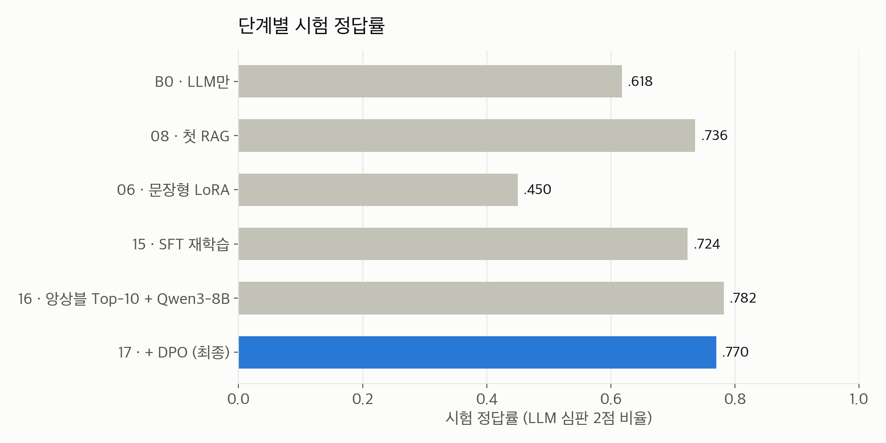
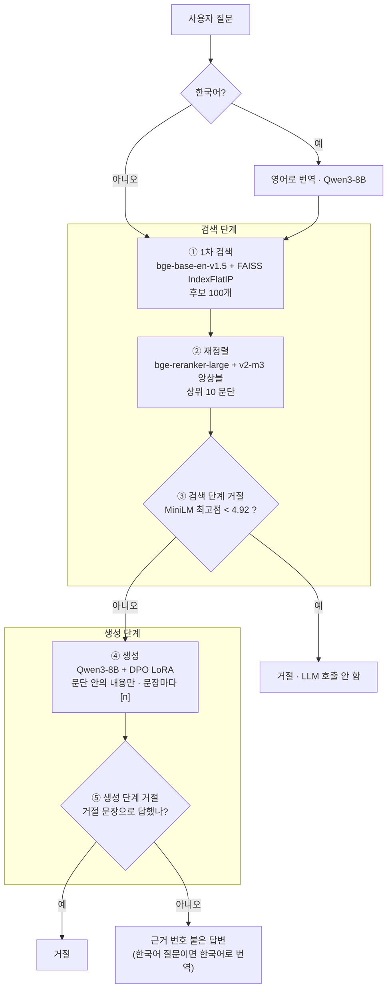
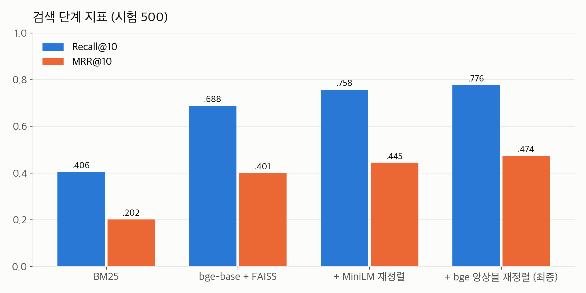
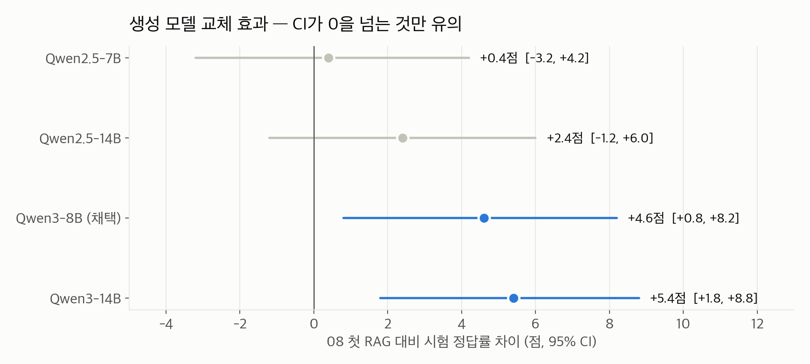
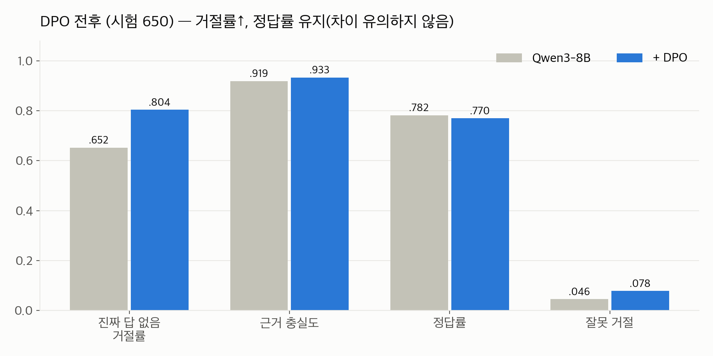
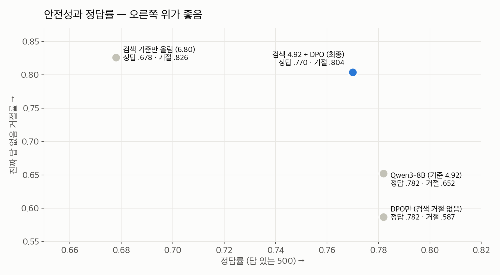
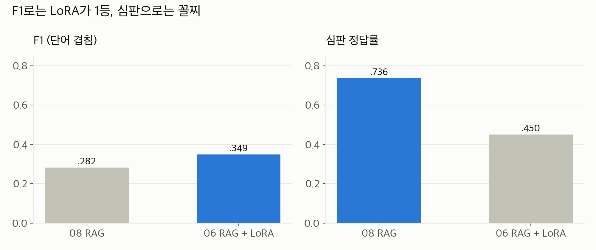
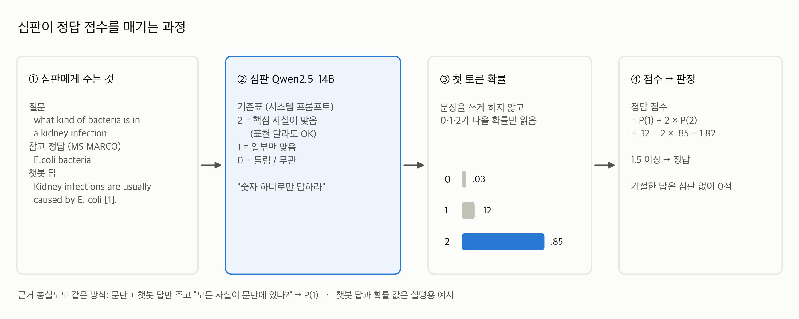
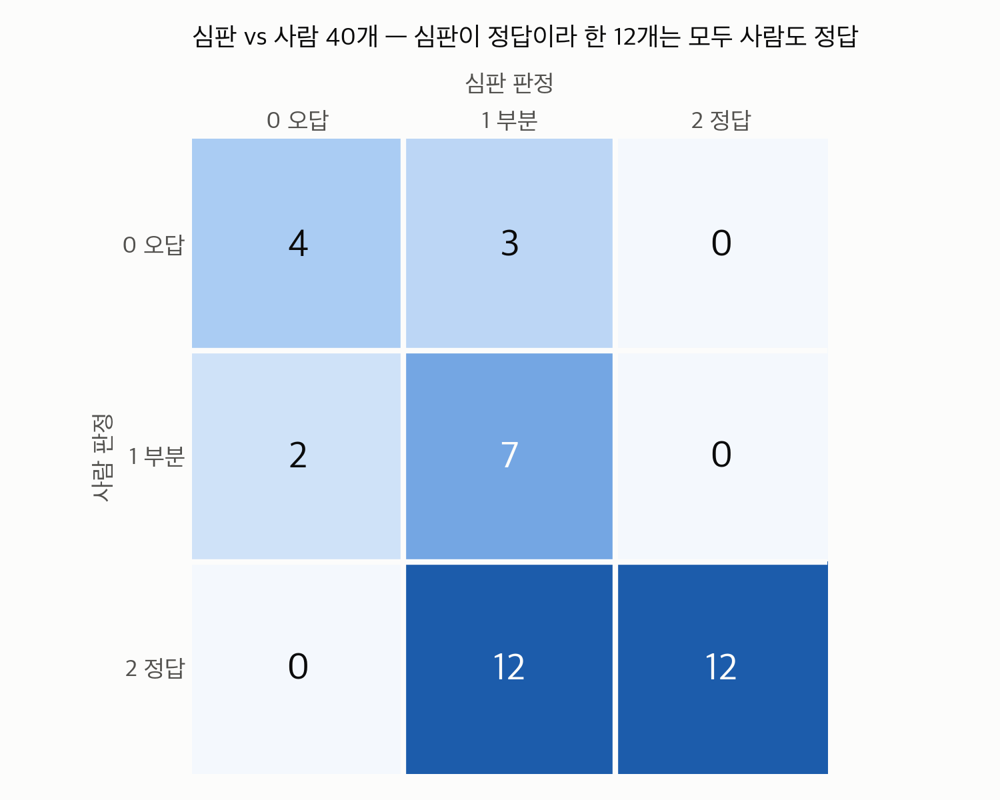
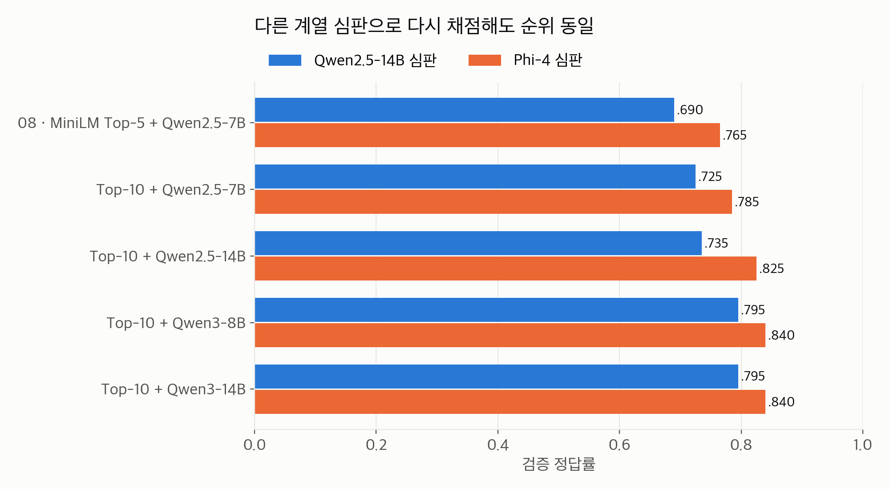

# 의료 RAG 챗봇 — 최종 파이프라인 발표 자료 (초안)

멋사 NLP 6기 · 프로젝트 02 지식 기반 QA · MS MARCO v2.1 건강 분야 · 2026-11-03

> 15분 발표 · 슬라이드 12장 (장당 약 1분 15초). 각 슬라이드 끝의 `출처`는 숫자를 가져온 파일입니다.
> 구성: 개요·데이터(1~3) → **검색 단계**(4~5) → **생성 단계**(6~8) → 지표(9~11) → 테스트·한계(12)

---

## 슬라이드 1. 한 줄 요약과 개선 흐름

**검색된 의료 문단 안에서만 답하고, 문장마다 출처 번호를 붙이고, 근거가 없으면 거절하는 의료 정보 챗봇**

- 과제의 핵심: **믿을 수 있는 지표를 먼저 세우고**, 그 지표로 단계별 개선을 증명하기

- 검색 추가(08)로 +11.8점 → 06·15 학습은 원본을 못 넘어 폐기 → 앙상블 Top-10 + Qwen3-8B로 +4.6점 → DPO로 정답률 유지하며 지어낸 답 35% → 20%

시도했지만 이득이 없어 뺀 것: Hybrid(RRF), 쿼리 재작성/HyDE, LLM 거절 판정, 도메인 판정, 프롬프트·거절 기준 조정

출처: `docs/v21_final_results.md`

---

## 슬라이드 2. 데이터셋 — MS MARCO QnA v2.1 건강 분야

**MS MARCO**: Microsoft Bing 실제 검색 질문 + 질문마다 웹 문단 10개 + 사람이 쓴 정답

- **왜 의료인가**: dev 분야 분포에서 의료가 13.1%로 가장 많음 (2위 날씨·여행 3.9%)
- **건강 질문 판정**: 질문의 문단 10개 중 **의료 사이트 33곳** 출처가 2개 이상 → train 119,659 / dev 13,494개

### 검색 DB: 문단 459,067개 (중복 25,666개 제거)

| 출처 | 문단 수 | 역할 |
|---|---:|---|
| dev 건강 질문 문단 | 131,143 | 평가 정답 문단이 여기 있음 |
| train 건강 질문 문단 | 229,697 | DB를 키워 검색을 어렵게 |
| dev 일반 질문 문단 | 98,227 | 방해 문단 (분야 밖 문서) |

### 평가셋: 시험 650 + 검증 300

| 묶음 | 수 | 재는 것 |
|---|---:|---|
| 건강·답 있음 | 500 | 검색 Recall/MRR, 답변 정답률 |
| 건강·답 없음 (`No Answer Present.`) | 100 | 지어내지 않고 거절하는가 |
| 분야 밖 | 50 | 분야 밖 거절 |

- **검증셋으로 설정을 고르고, 시험셋은 마지막에 한 번만 보고** → 시험셋 과적합 방지

출처: `final_v21/01_DB_임베딩_02_health_embedding.ipynb`, `docs/decisions.md`

---

## 슬라이드 3. 최종 파이프라인 — 검색 단계 / 생성 단계

| 구분 | 단계 | 모델 | 종류 |
|---|---|---|---|
| 검색 | ① 1차 검색 | BAAI/bge-base-en-v1.5 + FAISS | 사전학습 |
| 검색 | ② 재정렬 | BAAI/bge-reranker-large + bge-reranker-v2-m3 | 사전학습 |
| 검색 | ③ 거절 점수 | cross-encoder/ms-marco-MiniLM-L-6-v2 | 사전학습 |
| 생성 | ④ 생성 | Qwen/Qwen3-8B | 사전학습 |
| 생성 | ④⑤ 생성 어댑터 | **DPO LoRA** (r16, 224쌍) | **직접 학습** |
| 평가 | 심판 (챗봇엔 미사용) | Qwen/Qwen2.5-14B-Instruct | 사전학습 |

출처: `docs/refusal_flow_dpo.md`, `results/final/final_config.json`

---

## 슬라이드 4. [검색 단계] ① 1차 검색 — 임베딩 + FAISS

**FAISS**: Meta의 벡터 유사도 검색 라이브러리
1. 문단 459,067개를 bge-base-en-v1.5로 **768차원** 벡터화 (A100에서 166초)
2. FAISS 인덱스에 저장 (1.4GB) → 질문 벡터와 **내적이 가장 큰** 문단 100개 (정규화 → 내적 = 코사인 유사도)

- **`IndexFlatIP`(전부 비교)**: 46만 개는 근사 검색(IVF·HNSW) 없이도 충분히 빠르고, **근사 오차가 없어** 실험 비교가 흔들리지 않음
- **Vector DB 대신 인덱스 파일**: DB가 고정이라 추가·수정 불필요, Colab에서 서버 없이 파일 하나로 동작 (한계: DB 확장 시 전환 필요)

### BM25 vs Dense vs Hybrid(RRF) (시험 500)

| 방법 | R@1 | R@10 | R@100 | MRR@10 |
|---|---:|---:|---:|---:|
| BM25 (단어 일치) | .120 | .406 | .710 | .202 |
| **bge-base + FAISS (의미 유사도)** | **.272** | **.688** | **.938** | **.401** |
| Hybrid — RRF (`Σ 1/(60+순위)`) | – | .608 | – | – |

- dense가 BM25의 **약 2배**. RRF는 약한 BM25가 순위를 희석해 **dense 단독보다 낮아서 제외**
- R@100 = .938 → 후보 100개 안에는 정답이 대부분 있음. 문제는 **순위** → 재정렬로

출처: `results/retrieval/v2.1_retrieval.md`, `docs/decisions.md`

---

## 슬라이드 5. [검색 단계] ② 재정렬 + ③ 검색 단계 거절

### ② 크로스인코더 재정렬 → 상위 10
- 질문과 문단을 **함께** 넣어 관련도를 매김 (느리지만 정확) → 후보 100개에만 적용
- 재정렬 모델 6종 + 앙상블을 **검증 MRR@10으로** 선택

- MiniLM 대비 MRR@10 **+0.030, 95% CI [+0.008, +0.050]**. 의료 특화 모델(MedCPT, MRR@10 .234)이 오히려 최하위
- 넘기는 문단 5 → 10개: 정답 문단 포함률 .654 → .776

### ③ 관련 문단이 없으면 LLM 전에 거절
- **MiniLM 최고점 < 4.92**면 거절 (0.3~1.4초). 기준 = **검증셋 답 있는 질문 점수의 하위 5%** → 잘못 거절 약 5%
- 거절 구분력 AUC: 답 있음 vs 답 없음 **.804**, 답 있음 vs 분야 밖 **.917**

출처: `results/retrieval/11_rerank_compare_v21.md`, `docs/refusal_flow_dpo.md`

---

## 슬라이드 6. [생성 단계] ④ 생성 — Qwen3-8B + 근거 기반 프롬프트

프롬프트 규칙: ① 문서에 있는 사실로만 답함 ② 문장마다 `[1]`, `[2][4]` 출처 ③ 답이 없거나 건강 질문이 아니면 정해진 거절 문장 ④ 2~4문장

- 검색은 앙상블 Top-10으로 고정, 08 첫 RAG(시험 .736) 대비 차이. 점 = 차이, 선 = 95% 부트스트랩 CI

- **가장 큰 개선은 모델 세대 교체** (Qwen2.5 → Qwen3). 같은 계열 크기 키우기는 +2점, 유의하지 않음
- Qwen3-14B는 시험에서 조금 높지만 **검증에서 동점** → 미리 정한 규칙대로 가벼운 8B

출처: `results/generation/16_gen_compare_summary.md`

---

## 슬라이드 7. [생성 단계] ⑤ 왜 DPO를 직접 학습했나 + 학습 방법

다른 모델은 모두 사전학습 모델 그대로, **DPO만 우리가 직접 학습**

### 남은 문제: 문단에 답이 없을 때 Qwen3-8B가 **답을 지어냄** (진짜 답 없는 질문의 35%)

| 먼저 시도한 방법 | 시험 정답률 | 실패 이유 |
|---|---:|---|
| 06 문장형 LoRA | .450 | 답할 수 있는 질문까지 거절하도록 배움 |
| 15 SFT 재학습 | .724 | 좋은 답을 따라 하기만 해서 원본(.736)에서 멈춤 |
| 18 거절 기준 올리기 (4.92 → 6.80) | .678 | 지어낸 답은 줄지만 답할 질문까지 거절 |

→ SFT는 "좋은 답 따라 하기", **DPO는 "좋은 답과 나쁜 답을 비교해 나쁜 답 피하기"**

### 학습 방법
1. train 건강 질문마다 Qwen3-8B로 답 3개 생성 → 2. Qwen2.5-14B 심판이 채점 → 3. 좋은 답 vs 나쁜 답 짝짓기

| 경우 | 좋은 답 | 나쁜 답 | 쌍 수 |
|---|---|---|---:|
| 답 있는 질문 | 정답 + 근거 충실 | 오답 / 근거 없음 | 137 |
| 문단에 답 없음 | **거절** | 지어낸 답 | 67 |
| 라벨은 답 없음, 문단엔 답 있음 | 근거 충실한 답 | 근거 없는 답 | 20 |

- 거절 쌍 30% 이하로 제한 (06의 과잉 거절 방지) · LoRA r16, β 0.1, 1 epoch · TRL 없이 직접 구현

출처: `docs/refusal_flow_dpo.md`, `docs/v21_final_results.md`

---

## 슬라이드 8. [생성 단계] ⑤ DPO로 좋아진 성능

시험 650, 검색 단계 거절 기준은 동일 (MiniLM < 4.92)

- **좋아짐**: 진짜 답 없음 거절률 +15.2점 (지어낸 답 35% → 20%), 근거 충실도 +1.4점
- **지킴**: 정답률 −1.2점 (95% CI −3.8 ~ +1.4, 유의하지 않음), 문단에 답 있는 질문 답변률 .830 그대로
- **대가**: 잘못 거절 +3.2점

### 같은 안전성을 다른 방법으로 얻었다면

→ 검색 단계는 "명백히 관련 없는 질문"을 빠르게, DPO는 "문단은 있는데 답이 없는 경우"를 거름
→ **정답률은 통계적으로 같게 유지하면서, 지어낸 답을 약 40% 줄임**

출처: `docs/refusal_flow_dpo.md`, `results/generation/17_dpo_summary.md`

---

## 슬라이드 9. 지표 — 무엇을, 어떻게 재는가

| 구분 | 지표 | 정의 |
|---|---|---|
| 검색 | **Recall@k** / **MRR@10** | 상위 k개 안에 정답 문단이 있는 비율 / 첫 정답 순위의 역수 평균 (MS MARCO 공식) |
| 생성 | **정답률** | LLM 심판이 2점(정답)을 준 답의 비율. 거절은 0점 |
| 생성 | **근거 충실도** | 답한 것 중 모든 사실이 문단에 있는 비율 |
| 생성 | **잘못 거절 / 진짜 답 없음 거절률** | 답 있는 질문을 거절한 비율 / 답 없는 질문을 거절한 비율 |

### 왜 F1을 버렸나

- F1은 단어 겹침만 봐서 **짧게 답하는 LoRA가 최고점**. 실제 정답은 크게 줄어듦
- 지표를 바꾸자 "개선"으로 보였던 실험이 폐기됨 → 이후 모든 실험을 **심판 정답률**로 비교 (다음 슬라이드)

출처: `results/generation/14_judge_eval_summary.md`

---

## 슬라이드 10. 지표 — 심판(LLM-as-a-Judge)이란

**심판 = 챗봇의 답을 채점하는 별도의 LLM.** 사람 대신 큰 모델이 채점 기준표대로 점수를 매김

- 심판 모델: **Qwen2.5-14B-Instruct** — 챗봇 생성 모델(Qwen3-8B)과 다른, 더 큰 모델. **평가에만 쓰고 챗봇에는 넣지 않음**
- 왜 필요한가: 정답 표현이 달라도("E. coli" vs "a bacterium called E. coli") 핵심 사실이 같으면 맞는 답 → 단어 겹침(F1)으로는 못 잼

### 심판이 매기는 두 가지 점수

| 점수 | 심판에게 주는 것 | 기준 |
|---|---|---|
| **정답 점수** 0/1/2 | 질문 + MS MARCO 참고 정답 + 챗봇 답 | 2 = 참고 정답의 핵심 사실을 말함 (표현이 달라도, 맞는 내용이 더 있어도 정답) · 1 = 일부만 맞음 · 0 = 틀림/무관 |
| **근거 충실도** 0/1 | 검색된 문단 + 챗봇 답 (참고 정답 없음) | 1 = 답의 모든 사실이 문단에 있음 · 0 = 문단에 없는 사실이 하나라도 있음 (= 지어냄) |

### 심판이 정답 점수를 매기는 과정

- 문장을 생성시키지 않고 **첫 토큰이 `0`·`1`·`2`일 확률**만 읽음 → 샘플링이 없어 **같은 답은 언제나 같은 점수**
- 정답 점수 = P(1) + 2·P(2), **1.5 이상이면 정답** → 정답률 = 정답으로 판정된 답의 비율
- (질문, 답) 단위로 캐시 → 모든 실험이 같은 채점을 공유
- 그림의 질문·참고 정답은 실제 평가 데이터, 챗봇 답과 확률 값은 설명용 예시

출처: `final_v21/05_LLM심판_14_judge_eval_v21.ipynb`, `results/generation/14_judge_eval_summary.md`

---

## 슬라이드 11. 지표 — 이 숫자를 믿을 수 있는 이유

### ① 심판을 사람과 비교 — 사람 판정 40개 (F1 < 0.4로 낮게 나온 답)

- 오답(0) vs 부분 이상(1·2) 일치 **.88**
- 심판이 **정답(2)이라 한 12개는 사람도 모두 정답**. 틀릴 때는 늘 **깐깐한 쪽** (사람 정답 24개 중 12개를 부분으로)
- → 심판 정답률은 실제보다 **낮게 나올 수는 있어도 부풀려지지는 않음**

### ② 다른 심판으로 다시 채점

- 다른 계열 모델(Phi-4)이 채점하면 점수는 전체적으로 높지만 **모델 순위는 그대로** → 결론이 특정 심판에 의존하지 않음

### ③ 그 밖의 장치
- **검증 → 시험 분리**: 설정은 검증으로 고르고, 시험은 보고에만 사용
- **부트스트랩 95% CI**: 개선폭의 CI가 0을 포함하면 "유의하지 않음"으로 표기
- **같은 조건 비교**: 같은 질문·같은 후보 100개·같은 심판 캐시 공유

### 솔직하게 밝힐 한계
- 심판 세부 점수(1점 vs 2점)는 사람과 일치 .57 → **맞음/틀림 수준으로만 신뢰**. 사람 표본 40개로 작음
- 최종 DPO 선택은 18번 자동 선택의 **시험 결과(.678)를 보고 바꾼 것** → 엄밀한 검증-시험 분리는 아님

출처: `results/generation/14·16·17_*.md`, `docs/refusal_flow_dpo.md`

---

## 슬라이드 12. 챗봇 테스트와 한계

| 질문 (일상 표현) | 결과 | 초 |
|---|---|---:|
| what is it called when your blood sugar is too high all the time | 정답 · hyperglycemia | 3.7 |
| ringing sound in ears that won't go away | 정답 · tinnitus | 5.8 |
| 위궤양을 일으키는 세균이 뭐야? | 정답 · 헬리코박터 파일로리 (번역 경유) | 7.7 |
| can drinking coke every day cause dementia | 거절 · 관련 문서 없음 | 0.3 |
| shot you get after stepping on a rusty nail | **잘못 거절** · 검색 점수 3.9 < 4.92 | 0.5 |
| what is the capital of australia | **답함** (분야 밖인데 통과) | 1.6 |

- 영어 일상 표현 10개: 정답 8 · 부분 1 · 잘못 거절 1 (A100 기준 3~10초)

### 한계와 다음 단계
- **검색**: 남은 오답의 주원인. Top-10 포함률 .776 (상한 .890), 짧은 구어 질문은 잘못 거절 → 쿼리 확장, 구어체 평가셋
- **DB**: MS MARCO 문단뿐 → MedQuAD 등으로 확장 (이때 Vector DB 전환 검토)
- **분야 밖**: DB에 건강 외 문단 약 9.8만 개 → "호주 수도"에 답함 (도메인 판정은 정답 손실이 커서 끔)

출처: `docs/v21_final_results.md`
