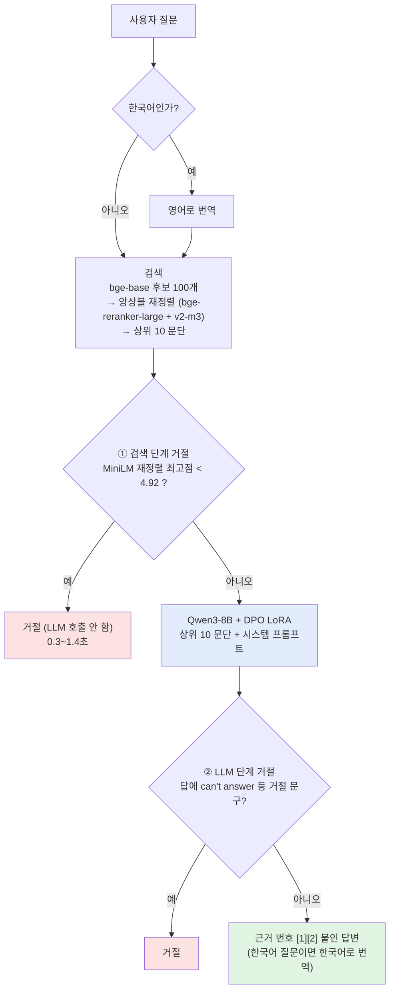

# 거절 흐름과 DPO (v2.1 최종 챗봇)

최종 챗봇([08f](../notebooks/v2.1/08f_final_chatbot_v21.ipynb), 설정 [final_config.json](../results/final/final_config.json))이 **어느 단계에서 거절하는지**와, 그중 **DPO가 맡는 부분**을 정리했습니다.

## 1. 전체 흐름

도메인 판정("건강 질문인가?")은 만들어 두었지만 **꺼져 있습니다** (`DOMAIN_GATE = False`). 켜면 시험 정답률이 .770에서 .626으로 떨어집니다. "how long are mri scans" 같은 의료 질문까지 걸러냈기 때문입니다.

## 2. 단계별 거절

| | ① 검색 단계 거절 | ② LLM 단계 거절 |
|---|---|---|
| 기준 | MiniLM(`ms-marco-MiniLM-L-6-v2`)이 매긴 후보 문단 점수 중 최고점이 4.92보다 낮음 | 시스템 프롬프트 규칙 3: 건강 질문이 아니거나 문서에 답이 없으면 정해진 거절 문장으로 답함 |
| 판정 방법 | 점수 비교 (`signal < refusal_threshold`) | 답에 `can't answer` / `cannot answer` / `unable to answer`가 있는지 확인 (`is_refusal`) |
| 막는 경우 | 관련 문단을 아예 찾지 못한 질문 (예: "how do i make kimchi") | 관련 문단은 찾았지만 그 안에 답이 없는 질문 |
| 비용 | LLM을 부르지 않아서 빠름 | LLM 생성까지 진행 (5~10초) |
| 약점 | 짧은 구어 질문은 점수가 낮게 나와 잘못 거절됨 (예: "녹슨 못 주사"는 3.78점) | DPO 전에는 답이 없어도 지어내는 경우가 많았음 |
| 고친 방법 | 기준 4.92를 그대로 둠 (19번 실험) | **DPO** (17번 실험) |

> 앙상블 재정렬 점수는 **문단 순서를 정하는 데만** 쓰고, ① 거절 판단은 08부터 써 온 MiniLM 점수로 합니다. 기준값의 단위를 08과 맞추기 위해서입니다.

## 3. DPO

### 목적
15 SFT v2는 원본 답 중 좋은 것만 따라 했기 때문에 원본과 같은 수준에서 멈췄습니다. DPO는 **나쁜 답을 피하도록** 직접 학습합니다. 여기서 나쁜 답은 오답, 문서에 없는 내용을 지어낸 답, 답이 있는데 거절한 답입니다. 흐름에서 DPO가 바꾸는 것은 **② LLM 단계** 하나뿐이고, ① 검색 단계는 그대로입니다.

### 선호 쌍 만들기 ([17_dpo_v21.ipynb](../notebooks/v2.1/17_dpo_v21.ipynb))
1. 학습 질문(15와 같은 train 질문, 시험·검증 제외)마다 Qwen3-8B로 답을 3개 만듭니다 (greedy 1개 + 샘플링 2개).
2. Qwen2.5-14B 심판이 세 가지를 채점합니다: 정답 여부(0~2), 근거 충실도(0/1), 문단에 답이 있는지.
3. 채점 결과로 좋은 답(chosen)과 나쁜 답(rejected)을 짝지어 쌍을 만듭니다.

| 경우 | 좋은 답 (chosen) | 나쁜 답 (rejected) | 쌍 수 |
|---|---|---|---:|
| 답 있는 질문 | 정답이면서 근거에 충실한 답 | 오답 또는 근거 없는 답 | 137 |
| 문단에 답 없음 (심판 < 0.2) | **거절** | 지어낸 답 | 67 |
| MS MARCO는 답 없음이지만 문단에 답 있음 (≥ 0.8) | 근거에 충실한 답 | 근거 없는 답 | 20 |
| **합계** | | | **224** |

- 거절이 좋은 답인 쌍은 전체의 30% 이하로 제한했습니다. 너무 많으면 모델이 거절을 과하게 배웁니다.
- "정답 vs 잘못 거절" 쌍도 만들 수 있게 해 두었지만, 실제로 만들어진 쌍은 0개였습니다.

### 학습
- 손실: `−log σ(β · [(log π(좋음) − log π_ref(좋음)) − (log π(나쁨) − log π_ref(나쁨))])`
- LoRA r16, β 0.1, lr 2e-5, 1 epoch
- 참조 모델: 같은 Qwen3-8B에서 LoRA를 끈 상태
- TRL 없이 직접 구현 (버전 충돌 방지)
- 어댑터: `rag_msmarco/health/dpo/adapter`

### 결과 (시험 650, ① 기준은 모두 MiniLM < 4.92)

| | Qwen3-8B | Qwen3-8B + DPO | 차이 |
|---|---:|---:|---|
| 정답률 (답 있는 500) | .782 | .770 | -1.2점, 95% CI -3.8 ~ +1.4 (유의하지 않음) |
| 잘못 거절 | .046 | .078 | +3.2점 |
| **진짜 답 없음 → 거절률** (46개) | .652 | **.804** | 지어낸 답 35% → 20% |
| 사실 답 있음 → 답변률 (54개) | .830 | .830 | 같음 |
| 근거 충실도 | .919 | .933 | |

① 기준은 그대로이므로, 진짜 답 없는 질문의 거절률이 늘어난 것은 **② LLM 단계에서 늘어난 몫**입니다.

## 4. 왜 두 단계를 다 두는가

| 설정 (시험 650) | 정답률 | 진짜 답 없음 거절 | 판단 |
|---|---:|---:|---|
| ①만 강하게 (MiniLM < 6.80, DPO 없음) | .678 | .826 | 정답 손실이 큼 |
| ② DPO만 (① 없음) | .782 | .587 | 지어낸 답이 다시 늘어남 |
| ① 기준 4.72 + ② DPO | .772 | .804 | 4.92와 사실상 같음 |
| **① 4.92 + ② DPO (최종)** | **.770** | **.804** | **채택** |

- ① 기준을 높여서 안전성을 얻으면 답할 수 있는 질문까지 거절하게 됩니다. ② DPO로 얻으면 정답률을 거의 지킵니다.
- ①을 없애면 문단이 엉뚱할 때도 LLM이 답하려고 해서 거절률이 떨어집니다.
- 그래서 ①은 "명백히 관련 없는 질문"을 빠르게 거르는 1차 관문으로, ②는 "문단은 있는데 답이 없는 경우"를 거르는 2차 관문으로 둡니다.

## 5. 남은 문제

- **①의 잘못 거절:** "shot you get after stepping on a rusty nail"은 3.9점, "녹슨 못을 밟으면 무슨 주사를 맞아야 해?"는 3.78점으로 LLM에 가기 전에 거절됩니다. 기준을 낮춰도 이득이 없었으므로(19번 실험), 구어 표현을 의학 용어로 잇는 검색 개선이 필요합니다.
- **분야 밖 질문:** DB에 건강 외 문단이 섞여 있어서 "what is the capital of australia"는 ①과 ②를 모두 통과해 답이 나옵니다. 도메인 판정은 손실이 커서 꺼 두었습니다.
- **DPO 선택 과정:** 18번 자동 선택(MiniLM < 6.80)이 시험에서 .678로 나온 것을 보고 17 DPO로 직접 바꿨습니다 ([final_config.json](../results/final/final_config.json)의 `note`). 즉 시험 결과를 보고 고른 것입니다. 검증 200에서도 DPO의 정답률은 .755로 Qwen3-8B 단독(.795)보다 낮고, 진짜 답 없음 거절률은 .725로 단독(.65)보다 높습니다.
