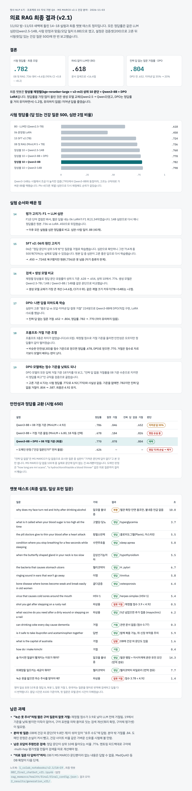

# 의료 RAG 최종 결과 (v2.1)

멋사 NLP 6기 · 프로젝트 02 지식 기반 QA · MS MARCO v2.1 건강 분야 · 2026-11-03

11/02 밤~11/03 새벽에 돌린 14~19 실험과 최종 챗봇 테스트 정리입니다. 모든 정답률은 같은 LLM 심판(Qwen2.5-14B, 사람 판정과 맞음/오답 일치 0.88)으로 쟀고, 설정은 검증셋(200)으로 고른 뒤 시험셋(답 있는 건강 질문 500)에 한 번 보고했습니다.

## 결론

| | 값 | 비교 |
|---|---|---|
| 시험 정답률 · 최고 조합 (앙상블 10 + Qwen3-8B) | **.782** | 08 첫 RAG .736 대비 +4.6점 (95% CI +0.8 ~ +8.2) |
| 시험 정답률 · 최종 챗봇 (+ DPO) | **.770** | 08 대비 +3.4점 (95% CI +0.2 ~ +7.2) |
| RAG 없이 LLM만 (B0) | .618 | 문서 검색으로 +15~16점 |
| 진짜 답 없는 질문 거절률 · DPO | **.804** | DPO 전 .652 (지어낸 답 35% → 20%) |

최종 챗봇은 **앙상블 재정렬(bge-reranker-large + v2-m3) 상위 10 문단 + Qwen3-8B + DPO LoRA**, 거절은 MiniLM 재정렬 최고점 < 4.92입니다. 정답률을 가장 많이 올린 것은 생성 모델 교체(Qwen2.5 → Qwen3)였고, DPO는 정답률을 거의 유지하면서(-1.2점, 유의하지 않음) 지어낸 답을 줄였습니다. 거절이 어느 단계에서 일어나는지와 DPO 상세는 [refusal_flow_dpo.md](refusal_flow_dpo.md)에 정리했습니다.

## 시험 정답률 (답 있는 건강 질문 500, 심판 2점 비율)

| 시스템 | 정답률 |
|---|---:|
| B0 · LLM만 (Qwen2.5-7B) | .618 |
| 06 문장형 LoRA | .450 |
| 15 SFT v2 (7B) | .724 |
| 08 첫 RAG (MiniLM 5 + 7B) | .736 |
| 앙상블 10 + Qwen2.5-14B | .760 |
| 앙상블 10 + Qwen3-8B + DPO (최종 챗봇) | .770 |
| **앙상블 10 + Qwen3-8B (검증 최고)** | **.782** |
| 앙상블 10 + Qwen3-14B | .790 |

Qwen3-14B는 시험에서 조금 더 높지만 검증(.795)에서 Qwen3-8B와 동점이라, 고르는 규칙대로 가벼운 8B를 택했습니다. Phi-4(다른 계열) 심판으로 다시 채점해도 순위가 같았습니다.

## 실험 순서와 배운 점

| # | 실험 | 내용 | 배운 점 |
|---|---|---|---|
| 14 | 평가 고치기: F1 → LLM 심판 | F1은 단어 겹침만 봐서 짧은 답을 내는 06 LoRA가 F1 최고(.349). 14B 심판으로 재니 원본 .736 vs LoRA .450 | 이후 모든 실험을 심판 정답률로 비교 (심판-사람 일치 .88) |
| 15 | SFT v2: 06의 원인 고치기 | 06은 "정답 문단이 상위 5개 밖"인 질문을 거절로 학습. 그런 714개 중 500개(70%)는 실제로 답 가능 | .450 → .724로 복구, 원본(.736)은 못 넘음 (자기 증류의 한계) |
| 16 | 검색 × 생성 모델 | 앙상블로 정답 문단 포함률 상위 5 .628 → .654, 상위 10 .776. Qwen2.5-7B/14B, Qwen3-8B/14B 비교 | 생성 모델 교체가 가장 큰 개선 (+4.6, CI 0 위). 같은 계열 크기 키우기는 +2 |
| 17 | DPO | 심판이 고른 "좋은 답 vs 오답·지어낸 답·잘못 거절" 224쌍, LoRA r16 (직접 구현) | 진짜 답 없음 거절 .652 → .804, 정답률 .782 → .770 (유의하지 않음) |
| 18 | 프롬프트·거절 기준 | 프롬프트 3종, 재정렬 점수 거절 기준 여러 개 | 프롬프트 차이 없음. 같은 안전성을 점수 기준으로 얻으면 정답률 .678, DPO로 얻으면 .770 |
| 19 | DPO 모델 거절 기준 | DPO 모델에 기준을 낮춰 LLM에 더 맡기기 | 4.72 ≈ 4.92 (.772 vs .770). 기준을 없애면 .782지만 진짜 답 없음 거절 .587 → 4.92 유지 |

## 안전성과 정답률 교환 (시험 650)

| 설정 | 정답률 | 잘못 거절 | 진짜 답 없음 거절 | 판단 |
|---|---:|---:|---:|---|
| Qwen3-8B + 08 거절 기준 (MiniLM < 4.92) | .786 | .046 | .652 | 지어낸 답 35% |
| Qwen3-8B + 거절 기준 올림 (MiniLM < 6.80) | .678 | .184 | .826 | 정답 손실 큼 |
| **Qwen3-8B + DPO + 08 거절 기준 (최종)** | **.770** | .078 | **.804** | **채택** |
| + 도메인 판정 ("건강 질문인가?" 먼저) | .626 | — | — | 정답 72개 손실 → 제거 |

"진짜 답 없음"은 MS MARCO가 답 없음으로 표시한 질문 중 심판이 "가져온 문단에 답이 없다"고 본 것만 셉니다 (100개 중 46개). 도메인 판정은 "how long are mri scans", "is hydrochlorothiazide a blood thinner" 같은 의료 질문까지 걸러서 뺐습니다.

## 챗봇 테스트 (최종 설정, 일상 표현 질문)

| 질문 | 기대 | 결과 | 초 |
|---|---|---|---:|
| why does my face turn red and itchy after drinking alcohol | 알코올 불내증 | 부분 · 혈관 확장·안면 홍조만 | 10.0 |
| what is it called when your blood sugar is too high all the time | 고혈당·당뇨 | 정답 · hyperglycemia | 3.7 |
| the pill doctors give to thin your blood after a heart attack | 항혈소판제 | 정답 · 클로피도그렐, 아스피린 | 5.5 |
| condition where you stop breathing for a few seconds while sleeping | 수면무호흡 | 정답 · sleep apnea | 5.0 |
| when the butterfly shaped gland in your neck is too slow | 갑상선기능저하 | 정답 · hypothyroidism | 5.5 |
| the bacteria that causes stomach ulcers | 헬리코박터 | 정답 · H. pylori | 6.7 |
| ringing sound in ears that won't go away | 이명 | 정답 · tinnitus | 5.8 |
| bone disease where bones become weak and break easily in old women | 골다공증 | 정답 · osteoporosis | 6.4 |
| virus that causes cold sores around the mouth | HSV-1 | 정답 · herpes simplex (HSV-1) | 5.4 |
| shot you get after stepping on a rusty nail | 파상풍 | **잘못 거절** · 재정렬 점수 3.9 < 4.92 | 0.5 |
| what vaccine do you need after a dirty wound or stepping on a nail | 파상풍 | 정답 · 5년 넘었으면 추가 접종 (mayoclinic) | 6.2 |
| can drinking coke every day cause dementia | 거절 | 거절 · 관련 문서 없음 | 0.3 |
| is it safe to take ibuprofen and acetaminophen together | 답변 | 정답 · 함께 복용 가능, 위·신장 부작용 주의 | 5.9 |
| what is the capital of australia | 거절 | **답함** · DB에 건강 외 문단 있음 | 1.6 |
| how do i make kimchi | 거절 | 거절 | 0.4 |
| 술 마시면 얼굴이 빨개지는 이유가 뭐야? | 알코올 불내증 | 정답 · 혈관 팽창 + 아시아계 유전 요인 (번역 경유) | 14.3 |
| 위궤양을 일으키는 세균이 뭐야? | 헬리코박터 | 정답 · 헬리코박터 파일로리 (번역 경유) | 7.7 |
| 녹슨 못을 밟으면 무슨 주사를 맞아야 해? | 파상풍 | **잘못 거절** · 점수 3.78 < 4.92 | 1.4 |

영어 일상 표현 10개 중 정답 8, 부분 1, 잘못 거절 1. 한국어는 질문을 영어로 번역해 검색하고 답을 다시 번역합니다. 응답 시간은 A100 기준입니다.

## 남은 과제

- **짧은 구어 질문의 잘못 거절** ("녹슨 못 주사"): 재정렬 점수가 낮아 LLM 전에 거절됨. 19에서 기준을 낮춰도 이득이 없어서, 구어 표현을 의학 용어로 잇는 검색 개선(쿼리 확장, 구어체 평가셋)이 필요.
- **분야 밖 질문**: DB에 건강 외 문단(약 9.8만 개)이 섞여 있어 "호주 수도"에 답함 (분야 밖 거절률 .84). 도메인 판정은 손실이 커서 뺌.
- **남은 오답의 주원인은 검색**: 정답 문단이 상위 10에 들어오는 비율 .776. 멘토링 피드백대로 구어체·multi-hop 평가셋으로 검색 개선.
- **"의료 질문 다 답하기"**: DB가 MS MARCO 문단뿐이라 없는 내용은 답할 수 없음. MedQuAD 등 DB 확장이 다음 단계.

노트북: `notebooks/v2.1/09~19`, 최종 챗봇 `notebooks/v2.1/08f_final_chatbot_v21.ipynb` (설정 `results/final/final_config.json`). 결과 요약: `results/generation/`.
