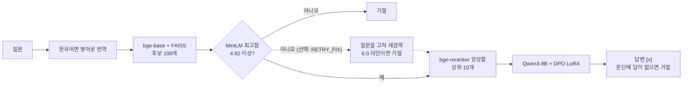

# RAG-Chat: 근거 안에서만 답하는 의료 RAG 챗봇

MS MARCO QnA v2.1의 건강 분야 문단 459,067개에서 근거를 찾아 답하는 의료 정보 챗봇입니다. 문장마다 출처 번호를 붙이고, 근거가 없으면 답하지 않고 거절합니다.

의료 답변에서는 틀린 답을 지어내는 것이 가장 위험합니다. 그래서 믿을 수 있는 지표를 먼저 세우고, 그 지표로 정답률과 안전성을 함께 개선하는 데 집중했습니다.

> 학습용 프로젝트이며, 답변은 의료 조언이 아닙니다.

## 결과

LLM 단일 대비 정답률이 15.2%p 올랐고, 답이 없는 질문에 지어낸 답은 35%에서 20%로 줄었습니다.

| 지표 (시험셋) | 최종 챗봇 | 비교 |
|---|---:|---|
| 정답률 (답 있는 건강 질문 500개) | 77.0% | LLM 단일 61.8%, 첫 RAG 73.6% |
| 진짜 답 없는 질문 거절률 | 80.4% | DPO 적용 전 65.2% (지어낸 답 35% → 20%) |
| 잘못 거절 | 7.8% | DPO 적용 전 4.6% |
| 근거 충실도 | 93.3% | DPO 적용 전 91.9% |
| 분야 밖 질문 거절률 | 84% | |
| 검색 Recall@10 / MRR@10 | 77.6% / 0.474 | bge-base만 68.8% / 0.401 |

정답률과 근거 충실도는 LLM 심판(Qwen2.5-14B)의 채점 결과입니다. 심판과 사람 판정의 맞음/틀림 일치도는 88%입니다. 위 수치는 오타 재검색을 끈 최종 챗봇 기준입니다. 최종 평가(23번)에서 재검색을 켜면 정답률 78.2%, 오타 질문 정답률 63.4%이지만 진짜 답 없는 질문 거절률이 73.9%로 떨어져, 발표 기준 챗봇에서는 재검색을 기본으로 껐습니다.

일상 표현 질문 10개를 직접 테스트한 결과는 정답 8개, 부분 정답 1개, 잘못 거절 1개입니다. 자세한 내용은 [최종 결과 정리](MedicalRAG/docs/v21_final_results.md)에 있습니다.

### 최종 파이프라인



점선은 기본으로 꺼져 있는 오타 재검색입니다. 노트북의 `RETRY_FIX = True`로 켤 수 있습니다.

| 역할 | 모델 | 구분 |
|---|---|---|
| 1차 검색 | `BAAI/bge-base-en-v1.5` + FAISS `IndexFlatIP` | 사전학습 |
| 거절 점수 | `cross-encoder/ms-marco-MiniLM-L-6-v2` | 사전학습 |
| 재정렬 | `BAAI/bge-reranker-large` + `BAAI/bge-reranker-v2-m3` | 사전학습 |
| 생성 | `Qwen/Qwen3-8B` | 사전학습 |
| 생성 어댑터 | DPO v1 LoRA (r16, 선호 쌍 224개) | 직접 학습 |
| 평가 심판 (챗봇에는 미사용) | `Qwen/Qwen2.5-14B-Instruct` | 사전학습 |

## 과정

| 단계 | 한 일 | 결과 |
|---|---|---|
| 1. 데이터 | 의료 사이트 33곳 기준으로 건강 질문을 고르고, 문단 DB와 평가셋 구성 | 문단 459,067개, 시험 650문항, 검증 300문항 |
| 2. 검색 | BM25, dense, Hybrid(RRF) 비교 | Recall@10: dense 68.8%, RRF 60.8%, BM25 40.6% |
| 3. 첫 RAG | Qwen2.5-7B 연결, 검색 점수 기준 거절 추가 | 정답률 61.8% → 73.6% |
| 4. 재정렬 | 재정렬 모델 6종과 앙상블 비교 | MRR@10 0.445 → 0.474 |
| 5. 학습 시도 | 문장형 LoRA, SFT 재학습 | 45.0%, 72.4%로 원본(73.6%)을 넘지 못해 폐기 |
| 6. 지표 교체 | F1 대신 LLM 심판으로 전체 실험 재평가 | 심판과 사람 판정 일치 88% |
| 7. 생성 모델 교체 | 문단 상위 10개 + 생성 모델 4종 비교 | Qwen3-8B로 78.2% (첫 RAG 대비 +4.6%p) |
| 8. DPO 학습 | 좋은 답과 나쁜 답의 선호 쌍 224개로 학습 | 지어낸 답 35% → 20%, 정답률 77.0% |
| 9. 오타 대응 | 점수가 낮은 질문을 고쳐 재검색 | 오타 질문 정답률 14.8% → 62.2% (실험 결과, 최종 챗봇에서는 기본으로 끔) |

단계별 노트북은 [`MedicalRAG/final_v21/`](MedicalRAG/final_v21/README.md)에 발표 순서대로 있습니다.

## 문제 해결

### F1이 나쁜 모델을 1등으로 골랐다

- 문제: 문장형 LoRA의 F1이 가장 높았지만(0.349 vs 0.282), 실제 정답은 크게 줄었습니다.
- 원인: F1은 단어 겹침만 봐서 짧은 답에 유리하고, 표현이 다른 정답은 잡아내지 못합니다.
- 해결: Qwen2.5-14B를 심판으로 두어 0·1·2점으로 채점하고, 모든 실험을 같은 기준으로 다시 비교했습니다.
- 결과: 심판 정답률은 LoRA 45.0%, 원본 73.6%였고, F1로는 개선처럼 보였던 실험을 폐기했습니다.

### 학습했더니 정답률이 떨어졌다

- 문제: 문장형 LoRA가 답할 수 있는 질문까지 거절했습니다.
- 원인: 정답 문단이 상위 5개 밖인 질문을 거절로 학습시켰는데, 그중 70%(714개 중 500개)는 실제로 답할 수 있는 질문이었습니다.
- 해결: 원인을 고쳐 심판이 고른 좋은 답으로 다시 학습했습니다(SFT).
- 결과: 정답률이 72.4%까지 회복했지만 원본은 넘지 못했습니다. 좋은 답을 따라 하는 방식의 한계로 보고, 나쁜 답을 직접 피하는 DPO로 넘어갔습니다.

### 답이 없어도 답을 지어냈다

- 문제: 진짜 답 없는 질문의 35%에서 문단에 없는 내용을 지어냈습니다.
- 첫 시도: 거절 기준을 4.92에서 6.80으로 올렸더니 거절률은 82.6%로 올랐지만, 정답률이 67.8%로 떨어졌습니다.
- 해결: 거절 기준은 그대로 두고, "거절 vs 지어낸 답" 등의 선호 쌍으로 DPO를 학습했습니다. 거절 쌍은 과잉 거절을 막으려고 30% 이하로 제한했습니다.
- 결과: 비슷한 거절률(80.4%)에서 정답률을 77.0%로 지켰습니다.

### 오타 하나로 정답 문단이 있어도 거절했다

- 문제: 점수 때문에 거절된 20개 중 다수가 오타나 이상한 표현이었습니다. "sympton"처럼 한 글자만 틀려도 거절 점수가 9.63에서 0.34로 떨어졌습니다.
- 해결: 점수가 낮을 때만 LLM으로 질문을 고쳐 다시 검색하고, 고친 질문은 더 높은 기준(6.0)을 통과해야 답하게 했습니다.
- 결과: 오타 질문 정답률이 14.8%에서 62.2%로 올랐습니다. 다만 최종 평가에서 진짜 답 없는 질문 거절률이 80.4%에서 73.9%로 떨어져, 발표 기준 챗봇에서는 기본으로 끄고 `RETRY_FIX = True`로 켤 수 있게 두었습니다.

### 분야 밖 질문에도 답한다 (미해결)

- 문제: DB에 건강 외 문단이 약 9.8만 개 섞여 있어 "what is the capital of australia"에도 답합니다.
- 시도: "건강 질문인가?"를 먼저 판정해 봤지만, "how long are mri scans" 같은 의료 질문까지 걸러 정답률이 62.6%로 떨어졌습니다.
- 현재: 정답 손실이 더 크다고 판단해 도메인 판정을 껐고, 분야 밖 거절률은 84%입니다.

## 고려사항

### 설계 판단

| 판단 | 이유 | 감수한 점 |
|---|---|---|
| DB를 의료 사이트 문단으로 제한하지 않음 | 평가 정답 문단 중 의료 사이트 문단이 40%뿐 | 분야 밖 문단이 섞임 |
| 문단을 더 쪼개지 않음 | 문단이 평균 55단어로 이미 짧음 | - |
| Vector DB 대신 FAISS 파일 사용 | DB가 고정이고, Colab에서 서버 없이 동작 | DB 확장 시 전환 필요 |
| 근사 검색 대신 전부 비교(FlatIP) | 근사 오차가 없어 실험 비교가 흔들리지 않음 | 규모가 커지면 느려짐 |
| 거절 관문을 두 곳에 둠 | 검색 단계는 무관한 질문을 빠르게, 생성 단계는 문단에 답이 없는 경우를 거름 | 짧은 구어 질문의 잘못 거절 |
| Qwen3-14B 대신 8B 선택 | 검증 정답률이 79.5%로 같아, 정한 규칙대로 가벼운 모델 선택 | 시험에서는 14B가 79.0%로 약간 높음 |
| 의료 특화 재정렬 모델을 쓰지 않음 | MedCPT가 비교 대상 중 최하위 (MRR@10 0.234) | - |
| 오타 재검색을 기본으로 끔 | 진짜 답 없는 질문 거절률이 80.4% → 73.9%로 떨어짐 | 오타 질문은 잘못 거절될 수 있음 |

### 정답률과 안전성

정답률만 보면 DPO를 뺀 78.2%가 가장 높습니다. 그래도 의료 분야에서는 지어낸 답을 줄이는 것이 더 중요하다고 보고 DPO를 선택했습니다. 정답률 -1.2%p는 95% 신뢰구간(-3.8 ~ +1.4)이 0을 포함해 유의하지 않았고, 잘못 거절이 3.2%p 늘어난 것은 감수했습니다.

| 설정 | 정답률 | 진짜 답 없음 거절률 | 판단 |
|---|---:|---:|---|
| 거절 기준 4.92, DPO 없음 | 78.2% | 65.2% | 지어낸 답 35% |
| 거절 기준 6.80, DPO 없음 | 67.8% | 82.6% | 정답 손실이 큼 |
| 검색 거절 없음, DPO | 78.2% | 58.7% | 지어낸 답이 다시 늘어남 |
| 거절 기준 4.92, DPO (최종) | 77.0% | 80.4% | 채택 |

### 평가를 믿을 수 있는가

- 보강한 점: 설정은 검증셋으로 고르고, 부트스트랩 95% 신뢰구간으로 차이를 확인했습니다. 다른 계열 심판(Phi-4)으로 다시 채점해도 검증 정답률 순위는 같았습니다.
- 심판의 한계: 일치도 88%는 F1이 낮은 답 40개로 잰 맞음/틀림 기준이고, 0·1·2점 3단계 일치도는 57%입니다.
- DPO 선택의 한계: 자동 선택된 6.80 기준의 시험 결과(67.8%)를 본 뒤 DPO로 직접 바꿨으므로, 시험 결과를 보고 고른 것입니다. 검증셋에서 DPO는 단독보다 정답률이 낮고(75.5% vs 79.5%) 거절률은 높았습니다(72.5% vs 65%).

### 남은 과제

- 검색: 정답 문단이 상위 10개에 드는 비율이 77.6%로, 남은 오답의 주원인입니다. 구어 표현을 의학 용어로 잇는 검색과 구어체 평가셋이 필요합니다.
- DB: MS MARCO 문단뿐이라 없는 내용은 답할 수 없습니다. MedQuAD 등으로 확장할 수 있습니다.
- 평가: 사람 판정 표본을 늘려야 합니다.

## 환경 설정: VS Code + Colab 런타임

노트북은 VS Code에서 열고, 코드는 Colab 서버의 GPU에서 실행합니다. 데이터와 모델은 용량 때문에 저장소에 없어, 팀 구글 드라이브의 `rag_msmarco` 폴더 권한이 필요합니다.

1. 저장소를 받아 VS Code로 엽니다.

   ```bash
   git clone https://github.com/rmfls0606/RAG-Chat.git
   code RAG-Chat
   ```

2. VS Code에 [Google Colab 확장](https://marketplace.visualstudio.com/items?itemName=Google.colab)을 설치합니다.
3. 공유받은 `rag_msmarco` 폴더의 바로가기를 내 드라이브 최상위에 추가합니다. 노트북은 `MyDrive/rag_msmarco/health/`를 읽습니다.
4. [`10_최종챗봇_08f_final_chatbot_v21.ipynb`](MedicalRAG/final_v21/10_최종챗봇_08f_final_chatbot_v21.ipynb)를 엽니다.
5. Select Kernel → Colab → New Colab Server에서 GPU를 고르고 Google 로그인을 허용합니다. A100을 권장하며, L4도 사용할 수 있습니다.
6. Run All을 실행합니다. A100 기준으로 준비에 약 10분이 걸립니다.
7. 마지막 셀에 출력되는 `https://xxxx.gradio.live` 링크로 접속합니다. 링크는 셀이 실행되는 동안만 열려 있습니다.
8. 사용을 마치면 셀을 중지하고 명령 팔레트에서 `Colab: Remove Server`를 실행합니다.

`drive.mount`가 VS Code에서 끝나지 않으면 명령 팔레트의 `Colab: Mount Google Drive to Server…`를 시도하고, 그래도 안 되면 같은 노트북을 Colab 웹에서 실행하세요. 오타 재검색은 기본으로 꺼져 있습니다. 켜려면 노트북의 `RETRY_FIX = True`로 바꾸고, 드라이브의 `final/final_config.json`에 `"retry_threshold": 6.0`이 있는지 확인하세요. 이 값이 없으면 고친 질문에도 기본 거절 기준(4.92)이 적용됩니다.
