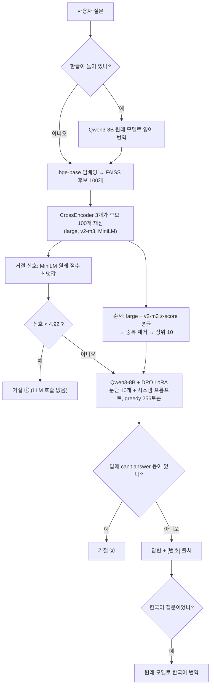

# MedicalRAG 프로젝트 전체 정리 (v2.1 최종 기준)

> 작성일 2026-11-03. 프로젝트에 참여하지 않은 사람이 **처음부터 끝까지 이해하고 검증할 수 있게** 레포의 노트북 코드, `MedicalRAG/docs/`, `MedicalRAG/results/`와 학습 산출물(`학습 자료/pairs.jsonl`, `학습 자료/train_log.csv`)을 직접 읽고 정리했습니다.
> 숫자는 모두 레포에 있는 결과 파일에서 가져왔습니다. **[추정]** 표시는 결과 파일에 없어서 계산하거나 유추한 내용이고, **[확인 필요]**는 담당자에게 물어봐야 하는 내용입니다.

---

## 목차

0. [한 장 요약](#0-한-장-요약)
1. [프로젝트 개요](#1-프로젝트-개요)
2. [용어 사전](#2-용어-사전)
3. [데이터 구축 (02)](#3-데이터-구축-02)
4. [최종 시스템 구조](#4-최종-시스템-구조)
5. [최종 챗봇 코드 분석 (08f)](#5-최종-챗봇-코드-분석-08f)
6. [실험 연대기: 어떻게 최종 설정에 도달했나](#6-실험-연대기-어떻게-최종-설정에-도달했나)
7. [성능 비교 종합](#7-성능-비교-종합)
8. [DPO 심층 분석 (pairs.jsonl · train_log.csv)](#8-dpo-심층-분석-pairsjsonl--train_logcsv)
9. [응답 시간](#9-응답-시간)
10. [평가 방법론과 신뢰도](#10-평가-방법론과-신뢰도)
11. [한계 · 리스크 · 코드 이슈](#11-한계--리스크--코드-이슈)
12. [파일 지도 (레포 + Google Drive)](#12-파일-지도-레포--google-drive)
13. [자주 묻는 질문](#13-자주-묻는-질문)
14. [담당자에게 확인할 것 / 추가로 있으면 좋은 파일](#14-담당자에게-확인할-것--추가로-있으면-좋은-파일)

---

## 0. 한 장 요약

**무엇을 만들었나**: MS MARCO의 건강 관련 웹 문단 약 46만 개에서 근거를 찾아, **찾은 문단 안의 내용으로만** 답하고 문장마다 `[번호]`로 출처를 다는 의료 QA 챗봇입니다. 근거가 없으면 답하지 않고 거절합니다.

**최종 결과물**
- 코드: [`MedicalRAG/notebooks/v2.1/08f_final_chatbot_v21.ipynb`](../MedicalRAG/notebooks/v2.1/08f_final_chatbot_v21.ipynb)
- 설정: [`MedicalRAG/results/final/final_config.json`](../MedicalRAG/results/final/final_config.json)
- 결과 정리: [`MedicalRAG/docs/v21_final_results.md`](../MedicalRAG/docs/v21_final_results.md)

**최종 구성**

```
질문 (한국어면 영어로 번역)
 → bge-base-en-v1.5 임베딩 + FAISS: 후보 100개
 → 재정렬 앙상블 (bge-reranker-large + bge-reranker-v2-m3): 상위 10개
 → [거절 ①] MiniLM 재정렬 최고점 < 4.92 이면 LLM을 부르지 않고 거절
 → Qwen3-8B + DPO LoRA 어댑터가 답 생성 (문장마다 [번호])
 → [거절 ②] LLM이 스스로 "can't answer"라고 답하면 거절
 → (한국어 질문이면 답을 한국어로 번역)
```

**핵심 숫자** (시험셋, LLM 심판 기준)

| 지표 | 값 | 비교 |
|---|---:|---|
| 정답률 (답이 있는 건강 질문 500) | **.770** | LLM만 .618 / 첫 RAG .736 |
| 진짜 답이 없는 질문의 거절률 | **.804** | DPO 전 .652 |
| 잘못 거절 (답이 있는데 거절) | .078 | DPO 전 .046 |
| 분야 밖 질문 거절률 | .84 | |

**성능을 올린 것, 순서대로**
1. 생성 모델 교체 Qwen2.5-7B → Qwen3-8B (+4.6점, 통계적으로 유의)
2. 재정렬 앙상블 + LLM에 넣는 문단 5 → 10개
3. DPO: 정답률은 거의 유지하면서 지어낸 답을 35% → 20%로 줄임

**효과가 없어서 뺀 것**: 문장형 LoRA(06), 재정렬 파인튜닝(07), 쿼리 재작성/HyDE(09), LLM 거절 판정(10), SFT v2(15), 프롬프트 변경(18), 도메인 판정(08f)

**이 문서에서 새로 분석한 것** (8장): DPO 학습 로그를 쌍 종류별로 나눠 보면, **loss가 내려간 것은 거의 전부 "거절 vs 지어낸 답" 쌍 덕분**이었습니다(이 쌍들의 보상 정확도 97%). "좋은 답 vs 나쁜 답" 쌍은 끝까지 **50% 근처, 즉 동전 던지기 수준**이었습니다. 다시 말해 DPO는 "답이 없으면 거절하기"는 배웠지만 "더 좋은 답 쓰기"는 배우지 못했습니다. 정답률이 오르지 않고 거절만 늘어난 결과와 맞아떨어집니다.

---

## 1. 프로젝트 개요

### 1.1 배경
- 멋사 NLP 6기, 프로젝트 02 "지식 기반 QA"
- 레포 루트 README: "외부 문서(MS MARCO)를 검색해서 그 문서를 근거로 답하는 챗봇 구현"
- 팀이 의료 분야를 고른 이유: MS MARCO dev 세트에서 의료 질문이 13.1%로 가장 많았습니다. 그다음은 날씨·여행 3.9%입니다 ([decisions.md](../MedicalRAG/docs/decisions.md)).

### 1.2 누가 무엇을 했나 (레포 구조로 본 것)

| 폴더 | 내용 | 최종 챗봇에 쓰였나 |
|---|---|---|
| `MedicalRAG/` | **본 파이프라인** (README에 담당 박규태) | ✅ |
| `Baseline/` | 검색 베이스라인 테스트 노트북 (test350) | ❌ |
| `Preprocess/` | 전처리 테스트 | ❌ |
| `VectorDB/` | Postgres 계열 벡터 DB 적재 (`docker-compose.yml`, `init.sql`, `load.py`) | ❌ (최종은 FAISS 파일) |
| `scripts/`, `docs/` (루트) | 의료 테스트셋 hold-out 방법론 | ❌ |
| `data/` (로컬, gitignore) | Qwen2.5-7B로 의료/비의료 라벨을 붙인 MS MARCO 질문 7,559개 | ❌ (v2.1은 URL 기준 선별) |
| `발표/` | 발표 자료 | 발표용 |
| `학습 자료/` | 학습 노트, DPO 데이터와 로그 | 참고 |

### 1.3 버전: v1.1과 v2.1

| | v1.1 | v2.1 (최종) |
|---|---|---|
| MS MARCO 버전 | QnA v1.1 (질문 약 10만 개) | QnA v2.1 (질문 약 100만 개) |
| 문단 DB | 142,605개 | **459,067개** |
| 평가셋 | 550 (건강 500 + 분야 밖 50) | **650** (답 있음 500 + 답 없음 100 + 분야 밖 50) |
| 답 없는 질문 | 없음 | 있음 (`No Answer Present.`) |
| 문장형 정답 (wellFormedAnswers) | 없음 | 있음 |
| 노트북 | `notebooks/v1.1/` (T1, T2, 03, 04, 05) | `notebooks/v2.1/` (02 ~ 19, 08f) |

> ⚠️ [`MedicalRAG/README.md`](../MedicalRAG/README.md)와 [`docs/drive_layout.md`](../MedicalRAG/docs/drive_layout.md)에는 "v1.1이 지금 기준"이라고 적혀 있는데, **업데이트가 안 된 내용**입니다. 최종은 v2.1입니다.

### 1.4 실행 환경
- 모든 노트북은 **Google Colab A100**에서 돌리는 것을 전제로 합니다.
- 데이터, 인덱스, 모델 어댑터는 용량 때문에 Google Drive `MyDrive/rag_msmarco/health/`에 있고, 레포에는 없습니다.
- 노트북은 출력이 지워진 채로 커밋되어 있어서, 결과는 `results/*.md` 요약으로 확인합니다.

---

## 2. 용어 사전

| 용어 | 뜻 | 이 프로젝트에서 |
|---|---|---|
| **RAG** | Retrieval-Augmented Generation. 문서를 검색한 뒤 그 문서를 LLM 입력에 넣어 답하게 하는 방식 | 프로젝트 전체 구조 |
| **BM25** | 단어가 겹치는 정도로 점수를 매기는 전통 검색 | 베이스라인. dense보다 약해서 탈락 |
| **Dense 검색 (임베딩 검색)** | 질문과 문단을 벡터로 바꾸고 코사인 유사도로 찾음 | `bge-base-en-v1.5` (768차원) |
| **FAISS** | 벡터 유사도 검색 라이브러리 | `IndexFlatIP`: 전부 비교(근사 없음), 내적 = 코사인 |
| **RRF** | 여러 검색 결과를 순위만으로 합치는 방법 (`Σ 1/(60+순위)`) | Hybrid 실험. dense 단독보다 낮아서 탈락 |
| **Cross-encoder (재정렬, reranker)** | 질문과 문단을 **같이** 넣고 관련도를 계산. 느리지만 정확 | 후보 100개의 순서를 다시 매김 |
| **Bi-encoder** | 질문과 문단을 **따로** 벡터로 바꿈. 빠르지만 덜 정확 | bge 임베딩 |
| **Recall@k (R@k)** | 상위 k개 안에 정답 문단이 하나라도 있는 질문의 비율 | 검색 성능 |
| **MRR@10** | 첫 정답 문단 순위의 역수를 평균 낸 값 (1등이면 1, 2등이면 0.5, 10등 밖이면 0) | MS MARCO 공식 지표 |
| **근거 R@5 / 정답 문단 포함률** | LLM에 넣은 문단 안에 정답 문단이 있는 비율 | 생성 단계의 상한 |
| **HyDE** | LLM이 쓴 "가상의 정답 문단"으로 검색하는 방법 | 09에서 실험. 효과 없음 |
| **LoRA** | 원래 가중치는 얼려 두고, 작은 저차원 행렬만 추가로 학습하는 방법 | 06, 15, 17에서 사용 |
| **SFT** | Supervised Fine-Tuning. 정답 예시를 그대로 따라 쓰게 학습 | 06, 15 |
| **DPO** | Direct Preference Optimization. "좋은 답 vs 나쁜 답" 쌍을 보고 좋은 답의 확률은 올리고 나쁜 답의 확률은 내리게 학습 | 17. **최종 어댑터** |
| **LLM-as-a-Judge (심판)** | 큰 LLM에게 답이 맞는지 채점을 시키는 방법 | Qwen2.5-14B, 교차 확인용 Phi-4 |
| **근거 충실도 (faithfulness)** | 답의 모든 사실이 넣어 준 문단에 있는지 | 심판이 0/1로 채점 |
| **잘못 거절** | 답이 있는 질문인데 거절한 비율 | 낮을수록 좋음 |
| **진짜 답 없음 거절률** | MS MARCO가 답 없음으로 표시한 질문 중, 심판도 "문단에 답이 없다"고 본 질문을 거절한 비율 | 높을수록 좋음 (안전성) |
| **95% 부트스트랩 CI** | 질문을 복원 추출로 다시 뽑아 차이의 신뢰구간을 구함 | 0을 포함하면 "유의하지 않음" |
| **z-score 정규화** | (값 − 평균) / 표준편차 | 재정렬 모델들의 점수 단위를 맞춰 평균 낼 때 사용 |
| **검증셋 / 시험셋** | 설정을 고를 때 쓰는 셋 / 최종 보고에만 쓰는 셋 | 검증 200(+답 없음 100), 시험 650 |

---

## 3. 데이터 구축 (02)

노트북: [`02_health_embedding.ipynb`](../MedicalRAG/notebooks/v2.1/02_health_embedding.ipynb)

### 3.1 원천: MS MARCO QnA v2.1
- 실제 Bing 검색 질문과, 질문마다 Bing이 가져온 웹 문단 약 10개, 사람이 쓴 정답으로 이루어져 있습니다.
- 문단마다 `is_selected=1`(정답을 쓸 때 근거로 쓴 문단) 표시가 있어서, 이걸 **정답 문단(gold)**으로 씁니다.
- 정답이 없는 질문은 `answers == ["No Answer Present."]`입니다.

### 3.2 건강 질문 판정 규칙
```python
MIN_HEALTH_HITS = 2   # 질문에 딸린 문단 10개 중 건강 사이트 문단이 2개 이상이면 건강 질문
HEALTH_SITES = ['webmd.com', 'mayoclinic.org', 'medicinenet.com', ..., 'psychologytoday.com']  # 33개
```
- dev 문단 100만 개의 출처를 세어 보고, 자주 나오는 의료·건강 사이트 33개를 골랐습니다.
- **한계**: 질문 내용이 아니라 **문단 출처**로 판정합니다. 그래서 의료가 아닌 질문도 섞여 있습니다. 예를 들어 "who sings fever", "what is a father's role in a child's life", "eustachian 밴드" 같은 질문이 08 오류 분석에서 나왔습니다.

### 3.3 문단 DB (`corpus.jsonl`, 459,067개)

| `src` | 출처 | 역할 |
|---|---|---|
| `dev_health` | dev 건강 질문 전체의 문단 | 평가 질문의 정답 문단이 여기 있음 |
| `train_health` | train 건강 질문 25,000개의 문단 (약 25만 개) | 건강 문단을 늘려 검색을 어렵게 만듦 |
| `dev_other` | dev 일반 질문 10,000개의 문단 (약 10만 개) | 방해 문단 (분야 밖 문서) |

- 내용이 같은 문단은 하나만 남기고, `pid` = 줄 번호입니다.
- 건강 질문에 딸린 문단은 출처가 건강 사이트가 아니어도 같이 넣습니다. 실제 검색 상황처럼 섞여 있어야 현실적이기 때문입니다.
- DB를 의료 사이트 문단으로만 제한하지 않은 이유: 평가 질문의 정답 문단 중 의료 사이트 문단이 40%뿐이라, 제한하면 평가가 성립하지 않습니다 ([decisions.md](../MedicalRAG/docs/decisions.md)).
- 문단 평균 길이는 55단어(3.3문장)로 이미 짧아서, 문장 단위로 다시 쪼개지 않았습니다.
- **결과**: DB에 건강과 무관한 문단이 약 9.8만 개 들어 있습니다. 그래서 "호주 수도는?" 같은 질문에도 답이 나옵니다.

### 3.4 평가셋 (`eval.jsonl`, 650개)

| 그룹 | 개수 | 조건 | 기대 동작 |
|---|---:|---|---|
| 건강 · 답 있음 | 500 | 정답 문장이 있고 정답 문단도 1개 이상 | 정답 |
| 건강 · 답 없음 | 100 | `No Answer Present.`이고 정답 문단 0개 | 거절 |
| 분야 밖 | 50 | 건강 사이트 문단이 하나도 없는 dev 질문. 이 질문들의 문단은 DB에 넣지 않음 | 거절 |

- 검증셋: `rerank/val.jsonl` 200개 (03에서 평가셋과 겹치지 않게 뽑음)
- 검증 생성셋: 위 200개 + 답 없음 100개 (`judge_eval/valgen_set.jsonl`, 14에서 만듦)
- 학습용: `train_health_qa.jsonl.gz` (train의 건강 질문 전체, 문단 원문 포함)
- **누수 방지**: 15와 17은 시험·검증·검증 생성셋 질문 ID를 `held_out`으로 빼고 학습합니다.

### 3.5 임베딩과 인덱스
- `BAAI/bge-base-en-v1.5`, fp16. 질문에만 `"Represent this sentence for searching relevant passages: "` 접두어를 붙입니다(bge 권장 방식).
- 벡터를 정규화하므로 내적이 곧 코사인 유사도입니다.
- `IndexFlatIP`: 근사 없이 전부 비교합니다. 50만 개 규모라 충분히 빠르고, 실험끼리 비교할 때 근사 오차가 끼어들지 않습니다.
- Vector DB(Chroma, Milvus, Qdrant 등) 대신 FAISS 파일 하나만 쓴 이유: DB를 한 번 만들고 바꾸지 않으며, Colab에서 서버 없이 Drive 파일만 읽으면 되기 때문입니다.

---

## 4. 최종 시스템 구조

### 4.1 흐름도



### 4.2 최종 설정 (`final_config.json`)

```json
{
 "generator": "Qwen/Qwen3-8B",
 "adapter": "rag_msmarco/health/dpo/adapter",
 "retrieval": "E10",
 "top_n": 10,
 "rerankers": ["BAAI/bge-reranker-large", "BAAI/bge-reranker-v2-m3"],
 "prompt": "P0",
 "refusal_rule": "08 규칙 (MiniLM < 4.92)",
 "refusal_signal": "cross-encoder/ms-marco-MiniLM-L-6-v2",
 "refusal_threshold": 4.921875,
 "note": "2026-11-03 03:30 수동 선택: 18 자동 선택(MiniLM<6.80)은 시험 정답률 .678로 과도한 거절 → 17 DPO(시험 정답 .770, 진짜 답없음 거절 .804) 사용. 아침에 사용자 확인 필요. 18 결과는 final_config_18.json"
}
```

**시스템 프롬프트 (P0)**
```
You are a careful medical information assistant.
Rules:
1. Answer ONLY with facts stated in the numbered documents. Do not add outside knowledge.
2. After each sentence, cite the supporting document numbers like [1] or [2][4].
3. If the question is not about health or medicine, or the documents do not contain the answer,
   reply with exactly this sentence: "Sorry, I can't answer that from the medical documents I have."
4. Answer in 2-4 short sentences.
```

### 4.3 컴포넌트별 정리

| 컴포넌트 | 모델 | 학습 여부 | 역할 |
|---|---|---|---|
| 임베딩 | `BAAI/bge-base-en-v1.5` | ❌ 공개 모델 그대로 | 46만 개 → 후보 100개 |
| 재정렬 1 | `BAAI/bge-reranker-large` (560M) | ❌ | 순서 정하기 |
| 재정렬 2 | `BAAI/bge-reranker-v2-m3` (568M) | ❌ | 순서 정하기 |
| 거절 신호 | `cross-encoder/ms-marco-MiniLM-L-6-v2` (22M) | ❌ | 최고점 < 4.92면 거절 |
| 생성 | `Qwen/Qwen3-8B` | ❌ 원래 가중치 그대로 | 답 생성, 번역 |
| DPO 어댑터 | LoRA r16 (Drive `health/dpo/adapter`) | ✅ **유일한 학습 결과물** | 답 생성할 때만 켬 |

**왜 거절 판단은 앙상블이 아니라 MiniLM으로 하나?** 08 때 정한 기준 4.92의 단위를 그대로 쓰기 위해서입니다. 기준값은 "검증 질문에서 MiniLM 최고점의 하위 5%", 즉 답이 있는 질문을 약 5% 잘못 거절하는 지점입니다. 11에서 거절 구분력(AUC)을 재 보니 MiniLM .804, large .813, v2-m3 .805로 비슷해서 바꾸지 않았습니다.

---

## 5. 최종 챗봇 코드 분석 (08f)

노트북: [`08f_final_chatbot_v21.ipynb`](../MedicalRAG/notebooks/v2.1/08f_final_chatbot_v21.ipynb). "런타임 → 모두 실행" 한 번이면 데모 테스트를 거쳐 Gradio 링크까지 나옵니다(A100, 약 10분).

### 셀 1–2: 설치, Drive, 설정
```python
!pip -q install -U sentence-transformers faiss-cpu peft gradio
!pip -q uninstall -y torchao        # 최신 peft와 Colab 기본 torchao(0.10)가 충돌해서 제거
CFG = json.load(open(f'{FINAL_DIR}/final_config.json'))
```
설정값을 모두 `CFG`에서 가져옵니다. 다른 실험에서 다른 설정을 고르면 이 노트북은 고치지 않아도 따라갑니다.

### 셀 3: 검색기
**불러오는 것**
- `corpus.jsonl`, `faiss_bge_flatip.index`, bge 임베딩 모델(fp16)
- CrossEncoder: `rerankers`와 `refusal_signal`을 합쳐 `dict.fromkeys`로 중복을 지운 뒤 하나씩 불러옵니다. 결과적으로 3개입니다.
  - `activation_fn=Identity()`: sigmoid를 거치지 않은 **원래 logit**을 씁니다. 기준값 4.92가 이 단위이기 때문입니다. sentence-transformers 버전마다 인자 이름이 달라서 `try/except`로 두 이름을 다 시도합니다.
  - 입력 길이 제한: MiniLM 256, 나머지 512

**출처 등급 `TIERS`**: URL 도메인을 보고 공공기관 / 병원·학회 / 상업 매체 / 커뮤니티·생활 / 사전 / 기타로 나눕니다. **화면에 보여 주기만 하고** 순위에는 영향이 없습니다. v1.1 05에서 '기타' 문단에 감점을 줘 봤지만, 근거 문단의 57%가 '기타'라서 감점 1만 줘도 검증 R@5가 .725 → .710으로 떨어져 쓰지 않았습니다.

**`retrieve(q)`**
```python
qe = emb.encode(['Represent this sentence ...' + q], normalize_embeddings=True)
_, ids = index.search(qe, K)                       # K = 100
raw = {n: m.predict(pairs) for n, m in RR.items()} # 모델 3개 × 100쌍
order = sum(zs(raw[n]) for n in CFG['rerankers']) / len(CFG['rerankers'])  # 질문 안에서 z-score 정규화한 뒤 평균
signal = float(raw[CFG['refusal_signal']].max())   # MiniLM 원래 점수의 최댓값 (후보 100개 전체에서)
# order 순으로 훑으면서 정규화한 텍스트가 같으면 건너뜀 → TOP_N(10)개가 모이면 멈춤
```
- z-score를 쓰는 이유: 모델마다 점수 범위가 달라서 그냥 더하면 범위가 큰 모델이 결과를 좌우합니다.
- `signal`은 중복 제거 **전**, 후보 100개 **전체**에서 구합니다. 순서는 앙상블 기준이고 거절은 MiniLM 기준이라, 두 기준이 서로 다릅니다.

### 셀 4: LLM과 `answer_one`
- `AutoModelForCausalLM`(bf16)에 `PeftModel.from_pretrained`로 DPO LoRA를 붙입니다. 가중치에 합치지 않은(unmerged) 상태입니다.
- **`generate(q, docs)`**: 문단을 `[i] (site) text` 형식으로 넣고, `enable_thinking=False`(Qwen3의 생각 모드 끔), greedy 디코딩으로 최대 256토큰을 만듭니다. 남은 `<think>` 태그는 지웁니다.
- **`translate(text, lang)`**: `llm.disable_adapter()`로 **LoRA를 끈 원래 모델**로 번역합니다. `[1]` 같은 인용 표시는 그대로 두라고 지시합니다.
- **`p_health(questions)`**: 도메인 판정입니다. LoRA를 끈 모델에게 "건강 질문인가? Yes/No"를 묻고, 마지막 위치 logit에서 `Yes`/`No` 두 토큰만 골라 softmax한 P(Yes)를 씁니다. **`DOMAIN_GATE=False`라서 쓰이지 않습니다.**
- **`is_refusal(a)`**: 답에 `can't answer` / `cannot answer` / `unable to answer`가 들어 있는지 문자열로 확인합니다.

**`answer_one(q)`의 흐름**
```
1. 한글이 들어 있으면 → translate(q, 'English') = q_en
2. retrieve(q_en) → docs, signal
3. (DOMAIN_GATE면) P(health) < 0.5 → why='domain'
4. signal < 4.92 → why='score'
5. why가 있으면 → 고정 거절 문구 반환 (LLM 호출 없음)
6. generate(q_en, docs) = ans_en
7. 한국어 질문이면: 거절문이면 한국어 거절문, 아니면 translate(ans_en, 'Korean')
8. 반환 (답, docs, answered, signal, 걸린 초, info)
```

### 셀 5: 도메인 판정 점검
- 시험 650개 전체에 `p_health`를 돌립니다. 그리고 "판정 때문에 **맞혔던 답을 몇 개 잃는가**"를 17의 DPO 답(`dpo/answers.jsonl`, 키 `E10|Qwen3-8B+DPO`)과 심판 캐시(`judge_eval/judgments.jsonl`)로 계산합니다.
- 결과: 기준 0.5에서 정답률이 .770 → .626으로 떨어집니다(맞힌 답 72개 손실). 그래서 껐습니다. "how long are mri scans", "is hydrochlorothiazide a blood thinner" 같은 의료 질문까지 걸러졌습니다.
- 결과는 `final/domain_gate_eval.json`에 저장됩니다.

### 셀 6: 데모 자동 테스트
일상 표현 10개, 분야 밖 2개, 한국어 3개를 `answer_one`에 돌리고 `final/chatbot_test.jsonl`에 저장합니다.

### 셀 7: Gradio 챗봇
- 왼쪽은 대화창, 오른쪽은 근거 문단(등급, 사이트, 원문, URL)입니다. 한국어 질문이면 번역된 영어 질문과 영어 원문 답도 보여 줍니다. 거절했을 때는 이유(점수 < 기준)를 표시합니다.
- 대화마다 `final/chat_log.jsonl`에 기록합니다(시간은 UTC + 9시간).
- `launch(share=True, prevent_thread_lock=True)`를 부른 뒤 `while True: sleep(1)`로 셀을 계속 돌립니다. ■(중지)를 누르면 `KeyboardInterrupt`가 나고 `demo.close()`가 실행됩니다.

### 셀 8: 종료
Drive를 `flush_and_unmount()`하고 `runtime.unassign()`으로 런타임을 반납합니다.

---

## 6. 실험 연대기: 어떻게 최종 설정에 도달했나

```
v1.1 연습 (T1 → T2 → 03 → 04 → 05)
   ↓  같은 흐름을 v2.1로
02 데이터 → 03 검색/재정렬 → 06 문장형 LoRA → 07 재정렬 학습 + LoRA → 08 첫 챗봇 (기준 4.92)
   ↓  멘토링(11/01): "실패 구간부터 드러내라", "LLM 심판을 써라"
09 쿼리 재작성 ✗ → 10 LLM 거절 판정 ✗ → 11 재정렬 앙상블 ✓
   ↓
14 평가를 F1에서 LLM 심판으로 교체 ✓ (이후 모든 비교의 기준)
   ↓
15 SFT v2 ✗ → 16 검색 × 생성 모델 (Qwen3-8B, E10) ✓ → 17 DPO ✓ → 18 프롬프트·거절 기준 (프롬프트 차이 없음, 기준 4.92 유지) → 19 DPO 모델 거절 기준 (4.92 유지)
   ↓
08f 최종 챗봇
```

### 6.1 v1.1 연습 (T1, T2, 03, 04, 05)

| 단계 | 결과 |
|---|---|
| 검색 MRR@10 | BM25 .213 → bge .384 → **MiniLM 재정렬 .449** |
| Hybrid(RRF) R@10 | .650 < dense .754 → **탈락** |
| 재정렬 모델 5종 | MiniLM-L-6이 MRR .450으로 최고(팀원 비교). 작고 빠름(fp16에서 질문당 1초 미만) |
| 치팅 상한 (정답 문장으로 검색) | R@10 .846. 질문 표현과 문단 표현의 차이가 검색 오류의 큰 원인 |
| 답변 F1 (건강 100) | LLM만 .207 → RAG .268 → RAG + LoRA **.395** |
| 분야 밖 거절률 | .28 → .48 → **.86** (재정렬 점수 기준 추가 후) |
| 05 LoRA | train 2,995개, 1 epoch 14분, loss 1.32 → 0.30. 답이 13.7단어로 짧아져 F1이 오름 |

> 나중에 14에서 밝혀지지만, **F1이 오른 이유는 답이 정답 길이에 맞춰 짧아졌기 때문**이었고 실제 품질이 좋아진 것은 아니었습니다.

### 6.2 03: 검색 베이스라인과 재정렬 (v2.1, 시험 500)

| 방법 | R@1 | R@5 | R@10 | R@100 | MRR@10 |
|---|---:|---:|---:|---:|---:|
| BM25 | .120 | .316 | .406 | .710 | .202 |
| bge-base (dense) | .272 | .592 | .688 | .938 | .401 |
| hybrid (RRF) | – | – | .608 | – | – |
| dense → MiniLM-L-6 (검증으로 선택) | .304 | – | .760 | – | .445 |
| dense → bge-reranker-base | .308 | – | .758 | – | .448 |
| 치팅 상한 (정답 문장으로 검색) | – | – | .890 | – | .700 |

**dense R@100 = .938**: 후보 100개 안에는 94% 확률로 정답 문단이 들어옵니다. 후보를 100개로 넓게 받는 이유가 이것입니다.

### 6.3 06: 문장형 답변 LoRA ✗
- 목적: 팀 목표인 "완전한 문장으로 답하기"에 맞춰 wellFormedAnswers로 학습
- 결과: ROUGE-L(문장형)은 .33 → .56으로 올랐지만 **정답 포함률은 .53 → .47로 떨어짐**
- 원인: 한 문장에 문서 하나의 사실만 담고, 정답 문서를 인용한 비율이 39%(28/71)뿐이었습니다. 그리고 **"정답 문단이 상위 5개 밖"인 질문을 거절로 학습**시켰습니다. 15에서 보니 이런 질문 714개 중 500개(70%)는 사실 답할 수 있는 질문이었습니다. 이 때문에 잘못 거절이 늘었습니다.

### 6.4 07: 재정렬 파인튜닝 + 데이터 정제 ✗
- MiniLM을 train 건강 질문으로 추가 학습(정답 1 + 헷갈리는 오답 7, listwise softmax)
- 짧은 정답의 단어가 50% 미만 들어 있는 문장형 정답은 제외
- 최종에 남은 것이 없습니다. 결과 요약 파일이 레포에 없어서 수치는 확인할 수 없습니다. **[확인 필요]**

### 6.5 08: 첫 RAG 챗봇 (v2.1)

설정: MiniLM 상위 5, Qwen2.5-7B, 06 LoRA. **거절 기준 4.92**(검증 하위 5%)를 여기서 정했습니다.

| | F1 | 정답 포함률 | 출처 표시율 | 잘못 거절 | 근거 R@5 | 답 없음 거절 | 분야 밖 거절 | 평균 단어 | 초/질문 |
|---|---:|---:|---:|---:|---:|---:|---:|---:|---:|
| B0 (LLM만) | .226 | .37 | – | .012 | – | .02 | .50 | 26.9 | 0.14 |
| RAG 기본 | .286 | .506 | .996 | .028 | .628 | .17 | .58 | 35.8 | 0.31 |
| RAG 개선 (중복 제거 + 거절 기준) | .282 | .495 | .996 | .056 | .628 | .44 | .82 | 35.7 | 0.28 |
| RAG 개선 + LoRA | .349 | .399 | 1.0 | .102 | .628 | .54 | .82 | 16.1 | 0.28 |

> 초/질문 값은 배치로 평가할 때 질문당 걸린 시간입니다. 챗봇에서 한 질문씩 처리할 때보다 훨씬 짧습니다(9장 참고).

**08 오류 분석** ([08_error_analysis_v21.md](../MedicalRAG/results/analysis/08_error_analysis_v21.md))
- 질문과 정답 문단의 키워드가 얼마나 겹치는지로 하·중·상 3구간으로 나누면, 근거 R@5가 상 .80 / 중 .64 / **하 .46**입니다. 겹침이 낮을수록 검색이 크게 떨어집니다.
- "정답 문단 있음 + F1 낮음" 154개 중 40개를 사람이 직접 판정했더니 정답 24, 부분 9, 오답 7이었습니다. **F1이 품질을 크게 과소평가**한다는 뜻이고, 이것이 14의 출발점입니다.
- 정답 라벨 자체가 틀린 경우도 있었습니다. 예: eustachian의 정답이 밴드 이름, "surfactant ... quizlet"의 정답이 "Yes" 하나

### 6.6 09: 쿼리 재작성 / HyDE ✗

| 시험, 재정렬 후 | R@10 | MRR@10 |
|---|---:|---:|
| **Q (원래 질문)** | **.758** | **.445** |
| HyDE | .712 | .428 |
| Q + HyDE | .734 | .440 |
| 다중 쿼리 | .758 | .446 |

실패 유형을 나눠 보면 이렇습니다.

| 겹침 구간 | 상위 10 안 | 후보 안, 순위 밖 (재정렬 실패) | 후보에도 없음 (검색 실패) |
|---|---:|---:|---:|
| 하 (165) | .618 | **.236** | .145 |
| 중 (187) | .781 | .187 | .032 |
| 상 (148) | .885 | .108 | .007 |

→ **재정렬 실패가 검색 실패보다 많습니다.** 그래서 다음 실험(11)은 쿼리가 아니라 재정렬을 바꿨습니다.

### 6.7 10: LLM 거절 판정 ✗
- 원래 Qwen에게 "이 문서로 답할 수 있나? YES/NO"를 먼저 묻는 방식입니다.
- 답 있음/없음 구분력(AUC): **재정렬 최고점 .804 > LLM 판정 .659**
- 판정을 넣으면 잘못 거절만 늘었습니다(.102 → .156). 그래서 점수 기준을 유지했습니다.

### 6.8 11: 재정렬 모델 비교 ✓

| 시험 500 (검증 MRR 순) | R@1 | R@5 | R@10 | MRR@10 | 검증 MRR@10 |
|---|---:|---:|---:|---:|---:|
| **앙상블 large + v2-m3** | .336 | .654 | .776 | **.474** | **.485** |
| v2-m3 + dense (α=0.1) | .324 | .672 | .776 | .468 | .475 |
| bge-reranker-large | .324 | .636 | .766 | .459 | .468 |
| bge-reranker-v2-m3 | .330 | .674 | .776 | .471 | .464 |
| MiniLM-L-6 (기준) | .304 | .628 | .758 | .445 | .453 |
| MiniLM-L-12 | .302 | .638 | .760 | .444 | .447 |
| bge-reranker-base | .310 | .648 | .758 | .449 | .436 |
| MedCPT (의료 특화) | .126 | .370 | .556 | .234 | .223 |

- 앙상블 − 기준 MRR 차이: **+0.030 (95% CI +0.008 ~ +0.050)**. 유의한 개선입니다.
- 의료 특화 모델인 MedCPT가 가장 나빴습니다. PubMed 논문으로 학습한 모델이라 웹 문단과 맞지 않았던 것으로 보입니다. **[추정]**

### 6.9 14: 평가 방식 교체, F1 → LLM 심판 ✓ (가장 중요한 방법론 변화)

**심판 구성** (Qwen2.5-14B-Instruct, 첫 토큰으로 나오는 숫자의 확률을 씀)

| 채점 | 프롬프트 요지 | 값 |
|---|---|---|
| 정답 (`c`) | 참고 정답과 핵심 사실을 비교 | 0 / 1 / 2 (기댓값 ≥ 1.5면 "정답") |
| 근거 충실도 (`f`) | 답의 모든 사실이 문단에 있나 | 0 / 1 |
| 근거 존재 (`e`) | 문단 중 하나라도 질문에 직접 답하나 | 0 / 1 |

결과는 질문과 답의 md5 해시를 키로 `judge_eval/judgments.jsonl`에 캐시합니다. 같은 답은 다시 채점하지 않습니다.

**심판 검증** (사람 판정 40개, 모두 F1 < 0.4인 답)

| 사람 \ 심판 | 0 | 1 | 2 |
|---|---:|---:|---:|
| 0 | 4 | 3 | 0 |
| 1 | 2 | 7 | 0 |
| 2 | 0 | **12** | 12 |

- 맞음/오답 일치 **.88**, 3단계 일치 .57
- **심판은 엄격한 편입니다.** 사람이 정답으로 본 24개 중 12개를 "부분"으로 매겼습니다. 그래서 실제 정답률은 보고된 값보다 높을 가능성이 있습니다. **[추정]**

**14 결과** (시험 650, 08 답변을 다시 채점)

| | 정답률 | F1 (참고) |
|---|---:|---:|
| B0 | .618 | .226 |
| RAG 기본 | .750 | .286 |
| **RAG 개선** | **.736** | .282 |
| RAG 개선 + LoRA (06) | **.450** | **.349** |

→ F1로는 1등이던 06 LoRA가 **실제로는 꼴찌**였습니다. 이후 모든 비교는 심판 정답률로 합니다.

### 6.10 15: SFT v2 ✗
- 원래 Qwen이 만든 답 3개 중 심판이 정답(2점)이고 근거에 충실하다고 본 답만 학습했습니다. 거절은 심판이 "문단에 답 없음(P < 0.2)"이라고 본 경우만 넣었습니다(전체의 8%).
- 학습 예시 1,994개(답변 1,835 + 거절 159), LoRA r16, lr 1e-4, 1 epoch
- 시험 정답률 .724 vs 원래 모델 .736: 차이 −1.2점, CI −3.4 ~ +1.0
- 06의 문제는 고쳤지만 **원래 모델을 넘지는 못했습니다.** 자기 답을 따라 쓰는 학습(자기 증류)이라, 원래 모델 수준이 상한입니다.

### 6.11 16: 검색 × 생성 모델 ✓ (가장 큰 개선)

**① 검색 비교 (생성은 7B로 고정)**

| | 검증 정답률 | 시험 정답률 | 정답 문단 포함률 (시험) |
|---|---:|---:|---:|
| S0 (MiniLM 상위 5) | .690 | .736 | .628 |
| E5 (앙상블 상위 5) | .710 | **.762** | .654 |
| **E10 (앙상블 상위 10)** | **.725** | .740 | **.776** |

> 시험에서는 E5가 더 높았지만, 규칙대로 **검증 기준인 E10**을 골랐습니다.

**② 생성 모델 비교 (검색 E10)**

| 모델 | 검증 | 시험 | 시험 − 08 (95% CI) | 근거 충실도 | 잘못 거절 |
|---|---:|---:|---|---:|---:|
| Qwen2.5-7B | .725 | .740 | +0.4 (−3.2 ~ +4.2) | .899 | .050 |
| Qwen2.5-14B | .735 | .760 | +2.4 (−1.2 ~ +6.0) | .926 | .054 |
| **Qwen3-8B** | **.795** | .782 | **+4.6 (+0.8 ~ +8.2)** | .919 | .046 |
| Qwen3-14B | .795 | .790 | +5.4 (+1.8 ~ +8.8) | .925 | .066 |

- Qwen3-8B와 14B가 검증에서 동점이라, 규칙대로 가벼운 8B를 택했습니다.
- **같은 계열에서 크기를 키우는 것보다(+2) 세대를 바꾸는 것이(+4.6) 효과가 컸습니다.**

**③ 교차 심판 (Phi-4, 다른 계열)**: 순위가 같았습니다. Qwen 심판이 Qwen 답을 편애한 것은 아니라는 근거입니다.

| | Qwen 심판 시험 | Phi-4 심판 시험 |
|---|---:|---:|
| S0 7B | .736 | .774 |
| E10 Qwen3-8B | .782 | .802 |
| E10 Qwen3-14B | .790 | .794 |

**④ 거절 지표 수정**: MS MARCO가 "답 없음"으로 표시한 시험 질문 100개를 심판이 다시 보니, 46개만 문단에 정말 답이 없었고 53개는 사실 답이 있었습니다. 그래서 **"진짜 답 없음 거절률"**이라는 지표를 새로 만들었습니다.

### 6.12 17: DPO ✓ (최종 어댑터)
자세한 내용은 [8장](#8-dpo-심층-분석-pairsjsonl--train_logcsv)에 있습니다. 요약하면 이렇습니다.

| 시험 650 | Qwen3-8B | + DPO |
|---|---:|---:|
| 정답률 | .782 | .770 (−1.2, CI −3.8 ~ +1.4) |
| 잘못 거절 | .046 | .078 |
| **진짜 답 없음 → 거절** | .652 | **.804** |
| 사실 답 있음 → 답변 | .830 | .830 |
| 근거 충실도 | .919 | .933 |
| 검증 정답률 | .795 | **.755** (−4점) |

### 6.13 18: 프롬프트 + 거절 기준 (DPO 없는 Qwen3-8B 기준)
- 프롬프트 3종: P0 기존 / P1 "문단이 일부만 답해도 그 부분은 답하기" / P2 P1 + "핵심 답 먼저". **검증에서 차이가 없었습니다**(.775 / .780 / .775).
- 거절 기준: 검증의 "균형 점수 = (정답률 + 진짜 답 없음 거절률) / 2" 기준으로 **MiniLM < 6.80**(검증 하위 30%)이 뽑혔습니다.
- 그런데 시험에서는 **정답률이 .678로 급락**했습니다(잘못 거절 .184). 그래서 사람이 이 선택을 버리고 17 DPO 모델과 4.92를 썼습니다.

| 같은 안전성을 얻는 두 방법 (시험) | 정답률 | 진짜 답 없음 거절 |
|---|---:|---:|
| 점수 기준을 올림 (6.80) | .678 | .826 |
| **DPO + 기준 4.92** | **.770** | .804 |

→ 안전성은 **기준을 올려서 얻는 것보다 DPO로 얻는 것이 정답률 손해가 훨씬 적습니다.**

### 6.14 19: DPO 모델의 거절 기준 다시 고르기
- 질문: DPO가 스스로 거절할 줄 아니, 기준을 낮춰 LLM에 더 맡겨도 되지 않을까? ("녹슨 못" 질문은 MiniLM 3.9점이라 LLM에 가기 전에 거절됨)
- 고르는 규칙: 검증에서 "진짜 답 없음 거절률 ≥ 08 기준 − 0.02"를 지키는 기준 중 정답률이 가장 높은 것

| 시험 650 | 정답률 | 잘못 거절 | 진짜 답 없음 거절 | 분야 밖 거절 |
|---|---:|---:|---:|---:|
| 기준 4.92 | .770 | .080 | .804 | .84 |
| 기준 4.72 (자동 선택) | .772 | .078 | .804 | .84 |
| 기준 없음 (LLM만 판단) | .782 | .050 | **.587** | **.68** |

→ 4.72와 4.92는 사실상 같습니다. 기준을 아예 없애면 지어낸 답이 다시 늘어납니다. **결론: 4.92 유지.** 다만 `final_config.json`은 19의 자동 선택(4.72)이 아니라 4.92 그대로입니다. 의도한 것으로 보이지만 **[확인 필요]**입니다.

---

## 7. 성능 비교 종합

### 7.1 최종 시험 정답률 순위 (답이 있는 건강 500, 심판 2점 비율)

| 시스템 | 정답률 |
|---|---:|
| 06 문장형 LoRA | .450 |
| B0 · LLM만 (Qwen2.5-7B) | .618 |
| 15 SFT v2 (7B) | .724 |
| 08 첫 RAG (MiniLM 5 + 7B) | .736 |
| 앙상블 10 + Qwen2.5-14B | .760 |
| **앙상블 10 + Qwen3-8B + DPO (최종 챗봇)** | **.770** |
| 앙상블 10 + Qwen3-8B (검증 최고) | .782 |
| 앙상블 10 + Qwen3-14B | .790 |

### 7.2 단계별 기여 (시험 기준) [추정: 실험마다 조건이 조금씩 달라서 단순히 더할 수는 없음]

| 변화 | 정답률 변화 | 근거 |
|---|---|---|
| LLM만 → RAG | +11.8 (.618 → .736) | 14 |
| MiniLM 5 → 앙상블 10 (7B) | +0.4 (.736 → .740) | 16 ① (검증에서는 +3.5) |
| 7B → Qwen3-8B | +4.2 (.740 → .782) | 16 ② |
| + DPO | −1.2 (.782 → .770), 대신 진짜 답 없음 거절 +15.2 | 17 |

### 7.3 안전성과 정답률 교환 (시험 650)

| 설정 | 정답률 | 잘못 거절 | 진짜 답 없음 거절 | 판단 |
|---|---:|---:|---:|---|
| Qwen3-8B + 4.92 | .786* | .046 | .652 | 지어낸 답 35% |
| Qwen3-8B + 6.80 | .678 | .184 | .826 | 정답 손실이 큼 |
| **Qwen3-8B + DPO + 4.92 (최종)** | **.770** | .078 | **.804** | **채택** |
| + 도메인 판정 | .626 | – | – | 정답 72개 손실 → 제거 |

\* 18에서 다시 생성한 값(.786)과 16의 값(.782)이 조금 다릅니다. 같은 설정을 다시 돌린 결과입니다.

### 7.4 챗봇 테스트 (일상 표현 질문, `chatbot_test.jsonl`)

| 질문 | 기대 | 결과 | 초 |
|---|---|---|---:|
| why does my face turn red and itchy after drinking alcohol | 알코올 불내증 | 부분 (홍조만) | 10.4 |
| what is it called when your blood sugar is too high all the time | 고혈당 | 정답 | 3.8 |
| the pill doctors give to thin your blood after a heart attack | 항혈소판제 | 정답 | 5.7 |
| condition where you stop breathing for a few seconds while sleeping | 수면무호흡 | 정답 | 5.1 |
| when the butterfly shaped gland in your neck is too slow | 갑상선기능저하 | 정답 | 5.8 |
| the bacteria that causes stomach ulcers | H. pylori | 정답 | 6.9 |
| ringing sound in ears that won't go away | 이명 | 정답 | 6.0 |
| bone disease where bones become weak ... in old women | 골다공증 | 정답 | 6.6 |
| virus that causes cold sores around the mouth | HSV-1 | 정답 | 5.5 |
| shot you get after stepping on a rusty nail | 파상풍 | **잘못 거절** (3.9 < 4.92) | 0.5 |
| what is the capital of australia | 거절 | **답함** (7.37 ≥ 4.92) | 1.6 |
| how do i make kimchi | 거절 | 거절 (0.81) | 0.4 |
| 술 마시면 얼굴이 빨개지는 이유가 뭐야? | 알코올 불내증 | 정답 (번역 경유) | 14.9 |
| 위궤양을 일으키는 세균이 뭐야? | 헬리코박터 | 정답 | 8.1 |
| 녹슨 못을 밟으면 무슨 주사를 맞아야 해? | 파상풍 | **잘못 거절** (3.78) | 1.4 |

영어 일상 표현 10개: 정답 8, 부분 1, 잘못 거절 1.

---

## 8. DPO 심층 분석 (pairs.jsonl · train_log.csv)

이 장은 `학습 자료/pairs.jsonl`(학습 데이터)과 `학습 자료/train_log.csv`(학습 로그)를 직접 분석한 내용입니다.

### 8.1 DPO란
같은 질문에 대한 좋은 답(chosen)과 나쁜 답(rejected)을 주고, 좋은 답의 확률은 올리고 나쁜 답의 확률은 내리게 학습합니다. 이때 **기준 모델(학습 전 모델)에서 너무 멀어지지 않게** β로 제약을 겁니다.

```
loss = −log σ( β · [ (log π(좋음) − log π_ref(좋음)) − (log π(나쁨) − log π_ref(나쁨)) ] )
                     └── 좋은 답 확률이 기준 대비 얼마나 올랐나 ──┘  └── 나쁜 답은 얼마나 올랐나 ──┘
```
- `margin` > 0 이면 모델이 좋은 답을 더 선호한다는 뜻입니다. `acc`(보상 정확도) = margin > 0인 비율입니다.
- 학습 전에는 margin = 0이므로 loss = −log σ(0) = **ln 2 = 0.693**입니다.

### 8.2 구현 (17 노트북 cell 15, TRL 없이 직접 구현)

| 항목 | 값 |
|---|---|
| 기반 모델 | Qwen3-8B (bf16) |
| 기준 모델 π_ref | **같은 모델에서 LoRA를 끈 상태** (`llm.disable_adapter()`). 모델을 두 번 올리지 않아 메모리 절약 |
| LoRA | r=16, α=32, dropout 0.05, 대상: q, k, v, o, gate, up, down (attention + MLP 전부) |
| β | 0.1 |
| 학습률 | 2e-5, warmup 5% 후 선형 감소 |
| 배치 | 1쌍씩, gradient accumulation 8 → **optimizer step 28회** |
| Epoch | 1 (데이터를 한 번만 봄) |
| 기타 | gradient checkpointing, grad clip 1.0, 최대 길이 1,400토큰 (초과 0개) |
| log π 계산 | 프롬프트 부분은 −100으로 가리고, **답 토큰의 log 확률 합** (길이로 나누지 않음) |
| 학습 문단 | 15의 **MiniLM 상위 5개** (실제 챗봇은 앙상블 상위 10개) |

### 8.3 학습 데이터 만드는 법 (cell 13)
1. 15의 후보 질문(`sft_v2/candidates.jsonl`, 답 있음 A 2,000 + 답 없음 N 465)마다 Qwen3-8B로 답 3개를 만듭니다(temperature 0.7, top_p 0.9).
2. Qwen2.5-14B 심판이 각 답에 정답 점수 `c`(0~2)와 근거 충실도 `f`(0~1)를, 질문에 근거 존재 `ev`(0~1)를 매깁니다.
3. 아래 규칙으로 쌍을 만듭니다.

| 그룹 | 조건 | chosen | rejected | 종류 |
|---|---|---|---|---|
| A | 좋은 답(c ≥ 1.5, f ≥ 0.5)과 나쁜 답(c < 0.5 또는 f < 0.5)이 모두 있음 | 가장 좋은 답 | 가장 나쁜 답 | 정답 vs 오답/근거 없음 |
| A | 좋은 답이 있고, 샘플 중 거절이 있고, ev ≥ 0.8 | 가장 좋은 답 | 거절문 | 정답 vs 잘못 거절 |
| A | 좋은 답이 없고 ev < 0.2 | 거절문 | 근거가 가장 약한 답 | 거절 vs 지어낸 답 |
| N | ev < 0.2 | 거절문 | 근거가 가장 약한 답 | 거절 vs 지어낸 답 |
| N | ev ≥ 0.8, 충실한 답(f ≥ 0.8)이 있고 거절도 있음 | 충실한 답 | 거절문 | 근거 답 vs 잘못 거절 |
| N | ev ≥ 0.8, 충실한 답과 불충실한 답(f < 0.5)이 있음 | 충실한 답 | 불충실한 답 | 근거 답 vs 근거 없음 |

4. **거절이 chosen인 쌍은 전체의 30% 이하로 제한**합니다(거절을 과하게 배우지 않게). `cap = int(157 × 0.3 / 0.7) = 67`

### 8.4 실제 데이터 (`pairs.jsonl`) 분석

| 항목 | 값 |
|---|---|
| 쌍 수 | **224** (질문 224개, 중복 없음) |
| 후보 질문 대비 비율 | 약 2,465개 중 224개 (약 9%) [추정: 15 라벨 표 기준] |
| 문단 수 | 모든 쌍이 5개 (MiniLM 상위 5) |
| chosen이 거절문 | 67 (= cap과 정확히 같음 → **거절 쌍이 더 있었는데 잘렸다**는 뜻) |
| rejected가 거절문 | **0** |
| 평균 길이 (거절 제외) | chosen 47.5단어, rejected 45.5단어 |

| 종류 | 개수 | 비율 |
|---|---:|---:|
| 정답 vs 오답/근거 없음 | 137 | 61% |
| 거절 vs 지어낸 답 | 67 | 30% |
| 근거 답 vs 근거 없음 | 20 | 9% |
| 정답 vs 잘못 거절 | **0** | 0% |
| 근거 답 vs 잘못 거절 | **0** | 0% |

**문제 1: "답이 있는데 거절하지 마라"를 가르치는 쌍이 0개입니다.**
- 그래서 모델은 거절하는 방향으로만 학습했습니다. 결과에서 **잘못 거절이 .046 → .078로 늘어난 것**과 맞습니다.
- 원인 [추정]: 이 쌍은 샘플 3개 중 하나라도 거절이 있어야 만들어지는데, Qwen3-8B는 문단에 답이 있을 때 거의 거절하지 않았을 것입니다.

**문제 2: 좋은 답과 나쁜 답이 매우 비슷합니다.**
- 거절 쌍을 뺀 157쌍에서 chosen과 rejected의 단어 겹침(Jaccard) 평균이 **0.60**이고, **51쌍(32%)은 0.7 이상**입니다.
- 예 (`what is an anticodon for start codon`):
  - chosen: "... The anticodon for the start codon (which is typically AUG) would be **UAC** [2][4][5]."
  - rejected: "... The start codon is typically AUG, so its corresponding anticodon is **UAC** [2][4]."
  - 두 답 모두 내용이 같습니다. 심판 점수의 작은 차이(노이즈)로 좋고 나쁨이 갈린 것으로 보입니다.

**문제 3: "지어낸 답"으로 분류된 것 중 맞는 답일 수 있는 경우가 있습니다.**
- 예 (`what is the thoracic vena cava also called`): rejected = "The thoracic vena cava is also called the superior vena cava [1]."
- 문단에 근거가 없다고 심판이 판정해서 "지어낸 답"이 된 것입니다. 사실 여부와 상관없이 **"문단에 없으면 거절"하도록 학습한다는 설계 의도에는 맞습니다.** 다만 심판이 근거 존재를 잘못 판정했다면 잘못된 신호가 됩니다.

### 8.5 학습 로그 (`train_log.csv`) 분석

로그는 224줄이고, 한 줄이 한 쌍의 `loss`와 `acc`(margin > 0이면 1)입니다. 쌍은 저장된 순서대로 학습했고 길이 때문에 빠진 쌍이 없어서, **로그 i번째 줄 = pairs.jsonl i번째 쌍**입니다.

**전체 추이 (28쌍씩 = optimizer step 약 3.5회씩)**

| 구간 | 평균 loss | 보상 정확도 | 최소 loss |
|---|---:|---:|---:|
| 0–27 | 0.688 | .36 | 0.628 |
| 28–55 | 0.670 | .61 | 0.567 |
| 56–83 | 0.624 | .68 | 0.400 |
| 84–111 | 0.584 | .64 | 0.134 |
| 112–139 | 0.569 | .61 | 0.177 |
| 140–167 | 0.549 | .61 | 0.039 |
| 168–195 | 0.481 | .71 | 0.035 |
| 196–223 | 0.561 | .64 | 0.020 |

- **처음 8줄은 loss가 정확히 0.6931 (= ln 2), acc 0입니다.** 첫 optimizer step 전이라 LoRA가 아직 0이고 정책 모델 = 기준 모델이기 때문입니다. **구현이 올바르다는 증거**입니다. 이 8개 때문에 첫 구간 정확도가 낮아 보입니다.
- loss는 0.69 → 0.5 근처로 내려갔습니다. 학습이 진행된 것은 맞습니다.
- 1 epoch이라 **각 쌍을 처음 보는 순간에 기록한 값**입니다. 그래서 이 로그는 학습 정확도라기보다 "앞의 쌍들로 배운 것이 새 쌍에 통하는가"에 가깝습니다.

**쌍 종류별로 나누면 그림이 완전히 달라집니다** ← 이 문서에서 새로 분석한 내용

| 종류 | 쌍 수 | 평균 loss | 보상 정확도 | 앞 절반 → 뒤 절반 정확도 |
|---|---:|---:|---:|---|
| 거절 vs 지어낸 답 | 67 | **0.346** | **.97** | .94 → **1.00** |
| 정답 vs 오답/근거 없음 | 137 | 0.697 | **.45** | .40 → .49 |
| 근거 답 vs 근거 없음 | 20 | 0.682 | .50 | .60 → .40 |

**해석**
- **거절 쌍**: 거의 바로 배웠습니다. 거절문은 항상 똑같은 한 문장이라, 그 문장의 확률만 올리면 되는 **쉬운 패턴**이기 때문입니다.
- **답 품질 쌍**(157개, 전체의 70%): 처음부터 끝까지 **50% 근처, 즉 동전 던지기 수준**입니다. loss도 ln 2(0.693)에서 거의 안 움직였습니다. 모델은 "더 좋은 답"과 "더 나쁜 답"을 구분하는 법을 **배우지 못했습니다.** 원인 후보는 이렇습니다.
  1. 좋은 답과 나쁜 답이 너무 비슷함 (8.4의 문제 2)
  2. 심판 판정의 노이즈 (사람과 3단계 일치가 .57)
  3. 학습량이 적음 (28 step, lr 2e-5, β 0.1)
- **전체 loss가 내려간 것은 거의 전부 거절 쌍 덕분**입니다.

### 8.6 그래서 학습이 잘 된 건가

| 질문 | 답 | 근거 |
|---|---|---|
| 구현이 올바른가 | ✅ | 시작 loss = ln 2, 기준 모델 = LoRA 끈 같은 모델 |
| 거절 행동을 배웠나 | ✅ | 거절 쌍 정확도 97% → 시험 진짜 답 없음 거절 .652 → .804 |
| 답 품질을 배웠나 | ❌ | 답 품질 쌍 정확도 45~50% (우연 수준) → 정답률 오르지 않음 (−1.2) |
| 잘못 거절을 막았나 | ❌ | 해당 쌍 0개 → 잘못 거절 .046 → .078 |
| 학습량이 충분한가 | △ | 28 step. 거절 학습에는 충분했고, 품질 학습에는 부족하거나 데이터가 적합하지 않음 |
| 학습 조건 = 사용 조건인가 | ❌ | 학습: MiniLM 상위 5 / 사용: 앙상블 상위 10 |
| 과적합 | 낮음 | 1 epoch, 시험 정답률이 유의하게 떨어지지 않음 |

**한 줄 결론**: DPO 어댑터는 사실상 **"근거가 없으면 거절하라"는 행동만 학습한 거절 어댑터**입니다. 설계 목표 중 안전성은 달성했고, 답 품질 향상은 달성하지 못했습니다.

### 8.7 개선 방향 [제안]
1. "정답 vs 잘못 거절" 쌍 만들기: 샘플에 거절이 없어도, ev ≥ 0.8이면 고정 거절문을 rejected로 넣으면 됩니다.
2. 답 품질 쌍은 점수 차이가 큰 경우(예: c 2 vs 0)만 쓰고, 비슷한 쌍(Jaccard ≥ 0.7)은 빼기
3. 학습 문단을 실제 사용과 같은 E10(앙상블 상위 10)으로 맞추기
4. 2~3 epoch 또는 β와 lr 조정, 그리고 학습 중 검증셋 margin 기록

---

## 9. 응답 시간

코드는 전체 시간(`sec`) 하나만 기록합니다. 아래 단계별 값은 경로가 서로 다른 결과끼리 시간을 빼서 **추정**한 것입니다(A100, `chatbot_test.jsonl`).

| 경로 | 실측 |
|---|---|
| 영어 → 점수로 거절 (검색만) | 0.4 ~ 0.5초 |
| 한국어 → 점수로 거절 (번역 + 검색) | 1.4초 |
| 영어 → 답변 | 1.6 ~ 10.4초 (보통 5~6초) |
| 한국어 → 답변 (번역 + 검색 + 생성 + 번역) | 8.1 ~ 14.9초 |

| 단계 | 추정 시간 |
|---|---|
| ① 질문 번역 (한국어만) | 약 0.9초 |
| ② 검색 (임베딩 + FAISS + 재정렬 3개 × 100쌍) | 약 0.5초 |
| ③ 답변 생성 | 약 1 ~ 10초 (답 길이에 비례: 44자 ≈ 1.1초, 440자 ≈ 9.9초) |
| ④ 답 번역 (한국어만) | 약 3 ~ 6초 |

- 시간 대부분은 **LLM 생성**입니다. 검색은 0.5초 정도입니다.
- 생성 속도는 초당 약 10~15토큰 [추정]입니다. A100에서 8B 모델치고 느린 편인데, HF 기본 `generate`에 배치 1이고 LoRA를 가중치에 합치지 않아 층마다 계산이 한 번 더 들어가기 때문입니다. LoRA를 합치지 않은 이유는 번역할 때 `disable_adapter()`로 끄기 위해서로 보입니다.
- 정확히 재려면 `answer_one` 안의 각 단계에 `time.time()`을 찍어 `info`에 넣으면 됩니다.

---

## 10. 평가 방법론과 신뢰도

### 10.1 잘한 점
- **검증과 시험 분리**: 설정은 검증 200(+답 없음 100)으로 고르고, 시험 650에는 결과를 보고만 하는 원칙입니다.
- **학습 데이터 누수 방지**: 시험, 검증, 검증 생성셋 질문 ID를 학습에서 뺐습니다.
- **F1의 한계를 발견하고 LLM 심판으로 교체**했습니다. 심판을 사람 판정으로 검증했고(.88), 다른 계열 심판(Phi-4)으로 교차 확인했습니다.
- 차이마다 **95% 부트스트랩 신뢰구간**을 붙였습니다.
- MS MARCO의 "답 없음" 라벨이 부정확하다는 것을 발견하고 **"진짜 답 없음"** 지표를 새로 만들었습니다.

### 10.2 주의할 점
- **최종 선택에 시험 결과가 끼어들었습니다.** 18의 자동 선택(6.80)을 시험 결과(.678)를 보고 버렸습니다. 검증에서 DPO의 정답률은 .755로 Qwen3-8B 단독(.795)보다 낮습니다. 엄격한 규칙대로라면 DPO가 아니라 Qwen3-8B 단독이 뽑혔어야 합니다. 그래서 최종 .770은 **약간 낙관적인 값**일 수 있습니다.
- **심판 검증 표본이 작습니다**: 40개, 그것도 F1 < 0.4인 답만 골랐습니다.
- **심판이 엄격합니다**: 사람이 정답으로 본 답의 절반을 "부분"으로 매겼습니다. 절대 수치보다 **시스템 간 상대 비교**로 읽는 게 안전합니다.
- **같은 설정인데 노트북마다 숫자가 조금 다릅니다**: Qwen3-8B 시험 정답률이 16에서 .782, 18에서 .786입니다. DPO 검증 정답률은 17에서 .755, 19에서 .765입니다. 다시 생성하면서 생긴 차이로 보입니다 **[확인 필요]**. 시험 500개 기준 1점 차이는 5문항입니다.
- **"진짜 답 없음"은 46문항뿐**이라, 거절률 .652 → .804는 7문항 차이입니다. 신뢰구간이 넓습니다.
- **분야 밖 평가가 50문항**뿐이고, "건강 질문"이 URL 기준으로 정해져 있습니다.

---

## 11. 한계 · 리스크 · 코드 이슈

### 11.1 시스템 한계 (문서에 이미 적혀 있음)

| 한계 | 예시 | 원인 | 방향 |
|---|---|---|---|
| 짧은 구어 질문을 잘못 거절 | "shot you get after stepping on a rusty nail" (3.9점) | 구어 표현과 의학 용어의 차이 → 재정렬 점수가 낮음 | 쿼리 확장, 구어체 평가셋 |
| 분야 밖 질문에 답함 | "what is the capital of australia" | DB에 건강 외 문단 약 9.8만 개 | DB 정제, 더 나은 도메인 판정 |
| 남은 오답은 주로 검색 탓 | 정답 문단의 상위 10 포함률 .776 | 겹침 '하' 구간 R@10 .655 | 재정렬, 검색 개선 |
| 데이터가 오래됨 | 2016년 무렵 웹 문단 | MS MARCO | MedQuAD 등으로 DB 확장 |
| 한국어는 번역을 거침 | 응답 8~15초 | DB가 영어 | 다국어 임베딩 |

### 11.2 코드 이슈 (이 문서에서 찾은 것)

| 위치 | 문제 | 영향 |
|---|---|---|
| 08f cell 9 (도메인 판정 점검) | `print(..., sep='\\n  ')`가 줄바꿈 대신 `\n` 글자를 그대로 출력 | 보기에만 영향 |
| 08f cell 9 | "모두 실행"을 하면 매번 650문항 판정을 돌림. `dpo/answers.jsonl`과 `judge_eval/judgments.jsonl`이 없으면 이 셀에서 멈춤 | 실행 시간, 의존성 |
| 08f cell 9 | `KEY='E10|Qwen3-8B+DPO'`를 직접 적어 둠 | 설정을 바꾸면 점검 대상 모델이 실제 챗봇과 달라짐 |
| 08f `answer_one` | `refusal_signal=None`인데 `refusal_threshold`가 있으면 `None < float`에서 TypeError | 지금 설정에서는 안 생김 |
| 08f `answer_one` | 도메인 판정을 검색 **뒤에** 함 | 판정이 꺼져 있어서 영향 없음 |
| 17 DPO | 학습 문단(MiniLM 5)과 사용 문단(앙상블 10)이 다름 | 학습과 사용 조건 불일치 |
| `final_config.json` | 19의 자동 선택(4.72)이 아니라 4.92 | 결과 차이는 거의 없음 |
| `MedicalRAG/README.md`, `drive_layout.md` | v1.1 기준으로 업데이트가 안 됨 | 처음 보는 사람이 헷갈림 |
| 모든 노트북 | 출력이 지워진 채로 커밋됨 | 레포만으로는 학습 곡선 같은 결과를 볼 수 없음 |

---

## 12. 파일 지도 (레포 + Google Drive)

### 12.1 레포

```
RAG-Chat/
├── MedicalRAG/
│   ├── README.md                 (v1.1 기준, 업데이트 안 됨)
│   ├── docs/
│   │   ├── v21_final_results.md  ★ 최종 결과 정리
│   │   ├── refusal_flow_dpo.md   ★ 거절 흐름과 DPO
│   │   ├── decisions.md          결정 기록 (10/29~10/30)
│   │   ├── project_summary.md    (v1.1 기준)
│   │   ├── how_to_run.md / drive_layout.md
│   │   └── mentoring/mentoring_1101_report.md
│   ├── notebooks/
│   │   ├── v1.1/   T1, T2, 03, 04, 05 (연습)
│   │   └── v2.1/   02, 03, 06, 07, 08, 08c, 08f★, 09, 10, 11, 14~19
│   └── results/
│       ├── final/        final_config.json★, final_config_18.json, chatbot_test.jsonl, domain_gate_eval.json, demo_questions.txt
│       ├── generation/   08, 10, 14~19 요약 (.md)
│       ├── retrieval/    v1.1, v2.1, 09, 11 요약
│       ├── analysis/     08 오류 분석
│       └── lora/         v1.1 05 LoRA (raw/train_log.csv는 v1.1 것, DPO 아님)
├── 학습 자료/
│   ├── pairs.jsonl       ★ DPO 학습 데이터 (224쌍)
│   ├── train_log.csv     ★ DPO 학습 로그 (224줄)
│   ├── BM25_FAISS_RRF/   용어 학습 노트
│   └── MedicalRAG_프로젝트_전체정리.md  (이 문서)
├── Baseline/ Preprocess/ VectorDB/ scripts/ docs/   다른 팀원의 작업 (최종에는 안 쓰임)
├── data/ (gitignore)     LLM 라벨링 의료 질문 (최종에는 안 쓰임)
└── 발표/
```

### 12.2 Google Drive `MyDrive/rag_msmarco/health/` (노트북 코드에서 따라가 확인)

| 경로 | 내용 | 만든 노트북 |
|---|---|---|
| `corpus.jsonl` | 문단 459,067개 `{pid, text, url, src}` | 02 |
| `eval.jsonl` | 평가 650 | 02 |
| `train_health_qa.jsonl.gz` | train 건강 질문 전체 | 02 |
| `corpus_emb_bge.npy`, `faiss_bge_flatip.index` | 임베딩, 인덱스 | 02 |
| `rerank/val.jsonl` | 검증 200 | 03 |
| `rag/eval_answers.jsonl` | 08 시험 답변 | 08 |
| `rerank2/` | 11 후보와 재정렬 점수 | 11 |
| `judge_eval/valgen_set.jsonl`, `val_answers.jsonl`, `judgments.jsonl` | 검증 생성셋, 답변, **심판 캐시** | 14 |
| `sft_v2/pool.jsonl`, `candidates.jsonl`, `labeled.jsonl`, `adapter/` | SFT v2 데이터와 어댑터 | 15 |
| `gen_compare/answers.jsonl`, `best_config.json` | 16 결과 | 16 |
| `dpo/candidates.jsonl`, **`pairs.jsonl`**, **`train_log.csv`**, **`adapter/`**, `answers.jsonl` | DPO | 17 |
| `final/final_config.json`, `chatbot_test.jsonl`, `chat_log.jsonl` | 최종 | 18 / 08f |
| `final_dpo/final_config_19.json` | 19 후보 설정 | 19 |

---

## 13. 자주 묻는 질문

**Q. top-k가 100이면 100번째 문단까지 LLM이 쓰나?**
아닙니다. 100은 **재정렬 모델에 넘기는 후보 수**이고, LLM에는 재정렬을 거친 **상위 10개만** 들어갑니다. bge 검색은 빠르지만 덜 정확해서 정답이 30등, 70등에 있는 경우가 흔합니다. 그래서 후보를 넓게 받고(R@100 .938), 정확한 CrossEncoder로 다시 줄을 세웁니다. LLM에 넣는 개수는 16에서 5개와 10개를 비교했습니다. 10개일 때 정답 문단 포함률이 .654 → .776으로 올라 10개를 골랐습니다.

**Q. Qwen을 학습한 건가?**
원래 가중치는 그대로 두고, 그 위에 덧붙이는 **DPO LoRA 어댑터(r16) 하나만** 학습했습니다. 번역과 도메인 판정을 할 때는 어댑터를 끄고 원래 모델을 씁니다. 06과 15에서도 학습했지만 원래 모델보다 못해서 버렸습니다.

**Q. 학습이 잘 된 상태인가?**
8.6을 보세요. 거절 행동은 배웠고, 답 품질은 배우지 못했습니다.

**Q. 왜 Qwen3-14B가 시험에서 더 좋은데 8B를 썼나?**
검증에서 둘 다 .795로 동점이라, 미리 정한 규칙대로 가벼운 모델을 골랐습니다. 시험에서의 차이(.790 vs .782)도 유의하지 않습니다.

**Q. 왜 Vector DB를 안 썼나?**
DB를 한 번 만들고 바꾸지 않습니다. Colab에서 서버 없이 Drive 파일 하나만 읽으면 되고, 전부 비교 방식이라 실험끼리 정확하게 비교할 수 있습니다. 실시간으로 문서를 추가해야 하면 그때 옮겨야 합니다.

**Q. 왜 BM25를 섞는 hybrid를 안 썼나?**
v1.1과 v2.1 모두에서 dense 단독보다 낮았습니다(v2.1 R@10 .608 vs .688).

**Q. 도메인 판정을 왜 껐나?**
분야 밖 질문은 조금 더 거르지만, 의료 질문까지 걸러서 맞힌 답 72개를 잃었습니다(.770 → .626).

**Q. 한국어 질문은 어떻게 처리하나?**
한글이 있으면 원래 Qwen3-8B로 영어로 번역해서 검색하고, 영어로 만든 답을 다시 한국어로 번역합니다. LLM을 세 번 부르므로 8~15초가 걸립니다.

---

## 14. 담당자에게 확인할 것 / 추가로 있으면 좋은 파일

### 14.1 확인할 질문
1. `final_config.json`의 note에 적힌 **"아침에 사용자 확인 필요"**: 수동 선택(DPO + 4.92)을 최종으로 확정했는지
2. 19의 자동 선택은 4.72인데 최종 설정은 4.92: 의도한 것인지
3. DPO에서 **"정답 vs 잘못 거절" 쌍이 0개**인 이유
4. 07(재정렬 파인튜닝 + LoRA) 결과 수치: 요약 파일이 레포에 없음
5. 같은 설정인데 노트북마다 정답률이 0.004~0.01 다른 이유 (16 vs 18, 17 vs 19)
6. README와 drive_layout을 v2.1 기준으로 고칠 계획

### 14.2 있으면 분석을 더 할 수 있는 파일 (Drive `rag_msmarco/health/`)

| 파일 | 있으면 할 수 있는 것 |
|---|---|
| `corpus.jsonl` (큼) | `pairs.jsonl`의 `pids`를 문단 원문으로 풀어서, "지어낸 답" 판정이 맞는지 직접 확인 |
| `dpo/candidates.jsonl` | 질문당 3개 샘플에서 거절이 몇 번 나왔는지 → "잘못 거절" 쌍이 0개인 원인 확인 |
| `judge_eval/judgments.jsonl` | 쌍마다 심판 점수 차이 → 비슷한 쌍이 노이즈인지 확인 |
| `dpo/answers.jsonl` | DPO 전후 답을 문항별로 비교 (어떤 질문에서 새로 거절했나) |
| `final/chat_log.jsonl` | 실제 사용 기록 분석 |
| 07 노트북 실행 결과 (`upgrade07/results_summary.md` 등) | 6.4절 수치 보완 |
